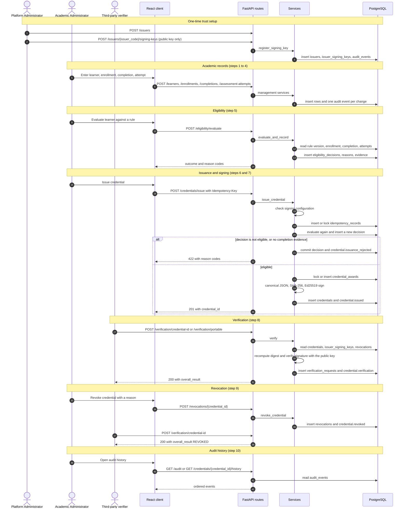
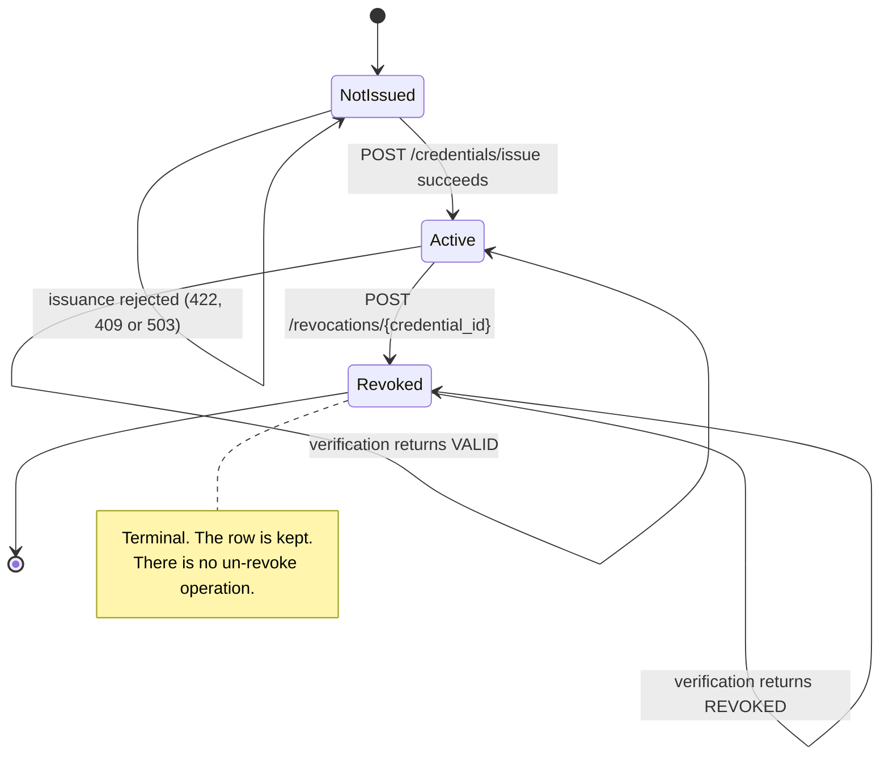
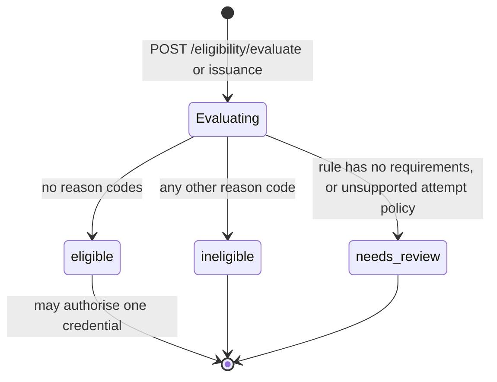
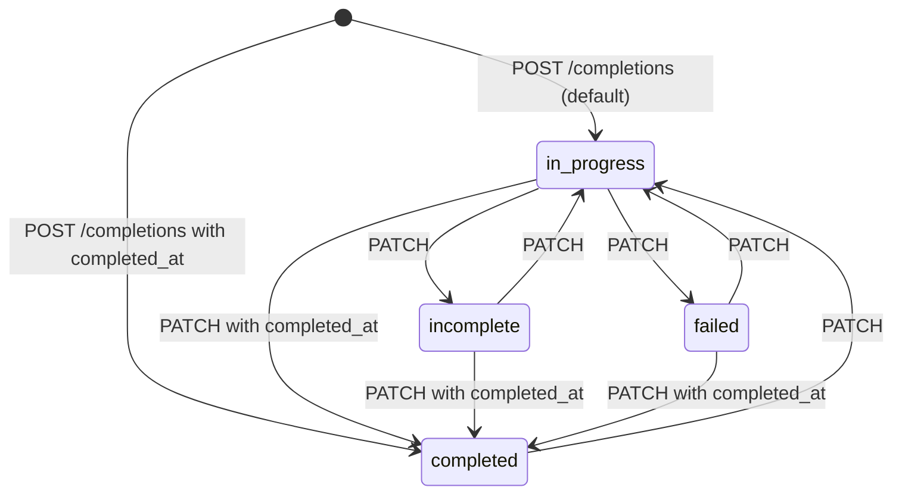
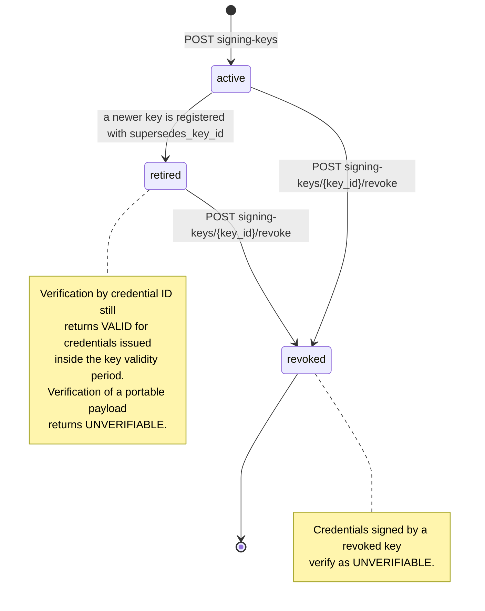
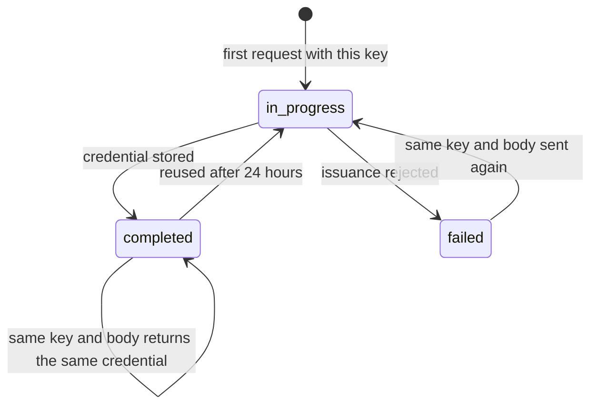

# Credential Lifecycle

How a credential moves through the system, from learner registration to audit history: who acts, which endpoint is called, which tables change, and what happens when a step fails.

Everything here was read from the source (`backend/app/services/`, `backend/app/api/v1/endpoints/business.py`) and the behaviour marked **recorded** was observed in a real run of the API on 2026-11-11. Request and response details for each endpoint are in [api-documentation.md](api-documentation.md); tables are in [database/database-schema.md](database/database-schema.md); the trust model is in [security.md](security.md).

## Contents

- [Actors](#actors)
- [Before the first credential](#before-the-first-credential)
- [The ten steps](#the-ten-steps)
- [Sequence diagram](#sequence-diagram)
- [State transitions](#state-transitions)
- [Exception paths and failure handling](#exception-paths-and-failure-handling)
- [What the lifecycle does not include](#what-the-lifecycle-does-not-include)

## Actors

| Actor | Role code | What the actor does in the lifecycle |
|---|---|---|
| Platform Administrator | `PLATFORM_ADMINISTRATOR` | Creates the issuer and registers or revokes its public signing key. Can also manage academic records. Cannot issue or revoke credentials. |
| Academic Administrator | `ACADEMIC_ADMINISTRATOR` | Manages learners, courses, rules, enrollments, completions and attempts. Evaluates eligibility. Issues and revokes credentials. |
| Learner | `LEARNER` | Reads the credentials linked to their own account. |
| Third-party verifier | none (anonymous) | Verifies a credential by ID or by portable payload. No account is needed. |

The split between the two administrator roles is deliberate: the person who controls the trust anchor (the key) is not the person who decides who receives a credential.

## Before the first credential

Three things must exist before any credential can be issued. None of them is created by the migration.

| Prerequisite | How it is created | Notes |
|---|---|---|
| Login accounts | `python scripts/bootstrap_demo_user.py`, once per account | There is no user-administration API. |
| An active issuer | `POST /api/v1/issuers` | `issuer_code` must equal `CREDENTIAL_SIGNING_ISSUER_CODE`. |
| A registered public key | `POST /api/v1/issuers/{issuer_code}/signing-keys` (Platform Administrator) | `key_id` must equal `CREDENTIAL_SIGNING_KEY_ID`, and the public key must be the pair of `CREDENTIAL_SIGNING_PRIVATE_KEY`. |

If any of these is missing or mismatched, issuance returns `503` and writes nothing.

## The ten steps

| # | Step | Actor | Endpoint | Tables written | Audit event |
|---|---|---|---|---|---|
| 1 | Learner registration | Academic or Platform Administrator | `POST /api/v1/learners` | `learners` | `learner.created` |
| 2 | Course enrollment | Academic or Platform Administrator | `POST /api/v1/enrollments` | `enrollments` | `enrollment.created` |
| 3 | Course completion | Academic or Platform Administrator | `POST /api/v1/completions`, `PATCH /api/v1/completions/{completion_id}` | `completion_records` | `completion.created`, `completion.status_updated` |
| 4 | Assessment recording | Academic or Platform Administrator | `POST /api/v1/assessment-attempts` | `assessment_attempts` | `assessment_attempt.created` |
| 5 | Eligibility evaluation | Academic or Platform Administrator | `POST /api/v1/eligibility/evaluate` | `eligibility_decisions`, `eligibility_reasons`, `eligibility_evidence` | `eligibility.evaluated` |
| 6 | Credential issuance | Academic Administrator | `POST /api/v1/credentials/issue` | `idempotency_records`, the three eligibility tables, `credential_awards`, `credentials` | `credential.issued` or `credential.issuance_rejected` |
| 7 | Signature generation | (part of step 6) | (part of step 6) | `credentials.canonical_payload`, `sha256_digest`, `signature` | (part of `credential.issued`) |
| 8 | Third-party verification | Anyone | `POST /api/v1/verification/credential-id`, `POST /api/v1/verification/portable` | `verification_requests` | `credential.verification` |
| 9 | Revocation | Academic Administrator | `POST /api/v1/revocations/{credential_id}` | `revocations` | `credential.revoked` |
| 10 | Audit history | Academic or Platform Administrator | `GET /api/v1/credentials/{credential_id}/history`, `GET /api/v1/audit` | none (read only) | none |

A course and a credential rule must also exist (`POST /api/v1/courses`, `POST /api/v1/credential-rules`). They are set up once per course, not once per learner.

### Step 1: Learner registration

The service allocates the next `LRN-NNNNNN` identifier unless the caller supplies one. Allocation takes a PostgreSQL advisory lock so two concurrent requests cannot receive the same number. Optionally, `user_id` links the learner to a login account; this is the only way a learner can later read their own credentials, and it can only be set at creation.

### Step 2: Course enrollment

The learner must not be archived and the course must have status `active`. A second non-cancelled enrollment for the same learner and course is rejected with `409`.

### Step 3: Course completion

A completion record belongs to one enrollment; there is at most one per enrollment. Status is one of `in_progress`, `completed`, `incomplete`, `failed`.

| Rule | Result when violated |
|---|---|
| `completed` requires `completed_at` | `422` |
| Any other status forbids `completed_at` | `422` |
| `completed_at` may not be earlier than `started_at` | `422` |
| `completed_at` may not be more than 5 minutes ahead of the server clock | `422` `completed_at cannot be in the future.` |

The five-minute allowance exists for client clocks that run slightly fast. Eligibility and issuance apply no allowance (see step 5).

### Step 4: Assessment recording

Every attempt is a new row. `attempt_number` increases per completion record and `assessment_key`. Nothing is overwritten: a retry is another row, and a correction is another row whose `supersedes_attempt_id` points at the one it replaces. Scores are on the `0-100` scale. A `graded` attempt must carry `score` and `graded_at`.

### Step 5: Eligibility evaluation

The evaluator (`backend/app/services/eligibility.py`, version string `credential-eligibility-v1`) takes a learner and a rule code and:

1. Finds the rule's active version that is in effect now. If several match, the highest `version_number` wins.
2. Reads the version's criteria: `requires_completion` (default `true`), `minimum_score`, and the attempt policy (`latest_graded` is the only supported policy).
3. Finds the learner's non-cancelled enrollments in the rule's course, and the most recently recorded completion record among them.
4. If a score is required, selects the **latest graded attempt that has not been superseded** (ordered by `graded_at`, then `attempt_number`).
5. Collects reason codes, decides the outcome, and stores the decision with a snapshot of the evidence and the SHA-256 of that snapshot.

| Reason code | Meaning | Outcome |
|---|---|---|
| (none) | All requirements met | `eligible` |
| `MISSING_ENROLLMENT` | No non-cancelled enrollment in the rule's course | `ineligible` |
| `MISSING_COMPLETION` | Completion is required and no completion record exists | `ineligible` |
| `COURSE_INCOMPLETE` | The completion record is not `completed` | `ineligible` |
| `COMPLETION_DATE_IN_FUTURE` | `completed_at` is later than the evaluation time | `ineligible` |
| `MISSING_ASSESSMENT` | A score is required and no usable graded attempt exists | `ineligible` |
| `ASSESSMENT_DATE_IN_FUTURE` | The selected attempt's `graded_at` is later than the evaluation time | `ineligible` |
| `ASSESSMENT_BELOW_THRESHOLD` | The selected score is below `minimum_score` | `ineligible` |
| `UNSUPPORTED_ATTEMPT_SELECTION_POLICY` | The stored policy is not `latest_graded` | `needs_review` |
| `RULE_HAS_NO_REQUIREMENTS` | The stored rule requires neither completion nor a score | `needs_review` |

Each call inserts a new decision. Decisions are never updated, so the history of evaluations for a learner is preserved. Evaluation alone never issues a credential.

**Latest attempt, not best attempt.** A learner who scored 88 and then retook the assessment and scored 55 is ineligible under a threshold of 70. This is the documented `latest_graded` policy, not a defect.

### Step 6: Credential issuance

`POST /api/v1/credentials/issue` does not accept a decision ID. It runs step 5 again inside the same transaction, so a credential is always based on the evidence as it is at the moment of issuance.

Order of checks in `issue_credential` (`backend/app/services/credentials.py`):

| Order | Check | Failure |
|---|---|---|
| 1 | `Idempotency-Key` is 8 to 200 characters | `400` (a request with no `Idempotency-Key` header at all is rejected earlier with `422`) |
| 2 | Signing material is configured, the issuer is active, the key is registered and active, the private key matches the registered public key, and the key is inside its validity period | `503` |
| 3 | The learner exists and is not archived | `404` |
| 4 | Idempotency record: same key with a different body | `409` |
| 5 | Idempotency record: same key, same body, already completed | Returns the existing credential (`201`) |
| 6 | Fresh eligibility evaluation is `eligible` | `422`, decision and `credential.issuance_rejected` event are committed |
| 7 | The decision's evidence contains a completion dated on or before the evaluation time (this applies to score-only rules too) | `422` `COMPLETION_REQUIRED_BEFORE_ISSUANCE` |
| 8 | The learner has no credential yet for this course scope | `409` |

When every check passes, the service locks or creates the `credential_awards` row, allocates the next `CRD-YYYY-NNNNNN` identifier under an advisory lock, signs (step 7), inserts the credential, marks the idempotency record `completed`, and writes `credential.issued`.

### Step 7: Signature generation

Signing happens inside step 6; it has no endpoint of its own.

1. Build the payload object:

   | Field | Source |
   |---|---|
   | `credential_id` | Newly allocated `CRD-YYYY-NNNNNN` |
   | `payload_version` | Constant `credential-v1` |
   | `signing_key_id` | `issuer_signing_keys.key_id` |
   | `learner_id` | `learners.learner_id` (`LRN-NNNNNN`) |
   | `course_code` | Course of the credential scope |
   | `issuer` | `{issuer_code, issuer_name}` |
   | `rule_version` | UUID of the rule version applied |
   | `issued_at` | Server time, ISO 8601 |
   | `completion` | `{completed_at}` from the decision's evidence |

2. Serialise it as canonical JSON: keys sorted, no whitespace, UTF-8, NaN forbidden.
3. Compute the SHA-256 digest of those bytes.
4. Sign the canonical bytes with the Ed25519 private key from `CREDENTIAL_SIGNING_PRIVATE_KEY`.
5. Store the canonical bytes, the 32-byte digest and the 64-byte signature in `credentials`.

The payload contains no learner name, no score and no contact data.

### Step 8: Third-party verification

Both routes are public and always answer `200`; the verdict is in `overall_result`.

**By credential ID.** The service loads the stored credential, recomputes the SHA-256 of the stored payload, compares it with the stored digest, verifies the stored signature with the registered public key, checks issuer and key trust at the recorded issue time, and looks for an effective revocation.

**By portable payload.** The service canonicalises the submitted payload, finds the public key named by `payload.issuer.issuer_code` and `payload.signing_key_id`, verifies the submitted signature, compares the submitted bytes with the stored payload if the claimed credential exists, checks trust at the current time, and looks for an effective revocation.

The three partial results combine in this order (first match wins):

| Order | Condition | `overall_result` |
|---|---|---|
| 1 | Credential ID lookup finds nothing | `NOT_FOUND` |
| 2 | Stored digest mismatch, or submitted payload differs from the stored payload | `TAMPERED` |
| 3 | Signature does not verify | `INVALID_SIGNATURE` |
| 4 | Integrity could not be established, or issuer trust is not `trusted` | `UNVERIFIABLE` |
| 5 | An effective revocation exists | `REVOKED` |
| 6 | Portable payload whose credential is not in the registry | `UNVERIFIABLE` |
| 7 | Otherwise | `VALID` |

Issuer trust is `trusted` only when the issuer is `active` and not archived, the key is not `revoked`, the stored fingerprint matches the stored public key, and the key's validity period covers the reference time.

Every call inserts a `verification_requests` row with a `VER-YYYY-NNNNNN` receipt and writes a `credential.verification` audit event with actor `anonymous-verifier`.

### Step 9: Revocation

The Academic Administrator supplies a `reason_code` (free text, up to 64 characters) and an optional `reason_detail`. The service locks the credential row, rejects a second revocation with `409`, and inserts a `revocations` row with `effective_at` set to the server time. The credential row, its payload and its signature are not changed. Revocation cannot be undone through the API.

From that moment, verification returns `REVOKED` (**recorded**).

### Step 10: Audit history

`GET /api/v1/credentials/{credential_id}/history` returns the audit events whose target is the credential, oldest first. In the recorded run the history of one credential read:

```text
credential.issued:success
credential.verification:valid
credential.verification:valid
credential.verification:tampered
credential.revoked:success
credential.verification:revoked
```

`GET /api/v1/audit` returns all events, newest first, optionally filtered by an exact `target_reference`.

Note that a rejected issuance is recorded against the **learner** (`target_type: learner`, `target_reference: LRN-NNNNNN`), because no credential exists yet. It appears in `GET /api/v1/audit?target_reference=LRN-000001`, not in a credential's history.

## Sequence diagram



## State transitions

### Credential

A credential has no status column. Its state is derived: `revoked` when a `revocations` row exists with `effective_at` in the past, otherwise `active`.



### Eligibility decision outcome

Each evaluation creates a new, immutable decision. The diagram shows how one evaluation reaches its outcome.



### Completion record

The service validates the target status and its dates, not the path taken. Any status can be set from any other.



### Issuer signing key



### Issuance idempotency record



## Exception paths and failure handling

### By step

| Step | Failure | Status | What is stored |
|---|---|---|---|
| Any protected call | No token, bad token, expired token, inactive account | `401` | Nothing |
| Any protected call | Role not allowed | `403` | Nothing |
| Any `/api/v1` call | NUL character in path, query or JSON | `422` | Nothing |
| 1 | Learner ID not in `LRN-NNNNNN` form | `422` | Nothing |
| 1 | Learner ID or linked account already used | `409` | Nothing |
| 2 | Learner archived or course not active | `404` | Nothing |
| 2 | Duplicate enrollment | `409` | Nothing |
| 3 | Future `completed_at`, missing `completed_at`, invalid status | `422` | Nothing |
| 3 | Second completion record for the enrollment | `409` | Nothing |
| 4 | Score outside 0 to 100, graded attempt without score or `graded_at` | `422` | Nothing |
| 5 | Unknown or archived rule | `404` | Nothing |
| 5 | Rule has no version in effect | `409` | Nothing |
| 5 | Requirements not met | `200` with `ineligible` | Decision, reasons, evidence, audit event |
| 6 | Signing not configured, key not registered, key revoked, key mismatch | `503` | Nothing |
| 6 | Not eligible | `422` | Decision, `credential.issuance_rejected`, idempotency record marked `failed` |
| 6 | Credential already exists for this learner and course | `409` | Rolled back |
| 6 | Same `Idempotency-Key`, different body | `409` | Nothing |
| 8 | Unknown ID | `200` `NOT_FOUND` | Verification request and audit event |
| 8 | Altered payload | `200` `TAMPERED` | Verification request and audit event |
| 8 | Unregistered issuer or key | `200` `UNVERIFIABLE` | Verification request and audit event |
| 8 | Credential ID longer than 15 characters | `422` | Nothing |
| 9 | Unknown credential | `404` | Nothing |
| 9 | Already revoked | `409` | Nothing |

### Transactions

- Each request uses one database session. A successful request commits once; a failure rolls back. The audit event is written in the same transaction as the change, so there is no change without an event and no event without a change.
- The one exception is a rejected issuance: the service commits the decision and the rejection event on purpose, then returns `422`, so that refused attempts are traceable.
- A unique-constraint violation that reaches the database is turned into `409`, never `500`.

### Concurrency

| Risk | Protection |
|---|---|
| Two requests issue the same credential at once | `SELECT ... FOR UPDATE` on the award row, the unique `(learner_id, credential_scope_id)` constraint, and the partial unique index on `credentials (award_id)`. An integration test inserts the same award row from two concurrent PostgreSQL sessions and expects exactly one to succeed. |
| Two requests allocate the same `CRD-`, `VER-` or `LRN-` number | A PostgreSQL advisory transaction lock per sequence and year |
| A client retries after a timeout | `Idempotency-Key`: the retry returns the credential that was already issued |
| A revocation races with another revocation | Row lock on the credential and the unique constraint on `revocations.credential_id` |

### Clock handling

- The server clock (UTC) decides `issued_at`, `evaluated_at`, `effective_at` and `occurred_at`. Clients cannot set them.
- A completion may be recorded up to five minutes ahead of the server clock, but it does not count as evidence until the server clock reaches it. In that window, evaluation returns `COMPLETION_DATE_IN_FUTURE`.
- Timestamps in requests must carry a timezone and fall in the years 1900 to 2999.

### Consequences that are easy to miss

| Situation | Behaviour |
|---|---|
| A completion is changed to `failed` after the credential was issued | The credential stays `active`. Nothing revokes it automatically. An administrator must revoke it. |
| A signing key is revoked | Every credential it signed verifies as `UNVERIFIABLE`, including credentials that were already revoked (**recorded**). Issuance returns `503` until a new active key is registered and configured. |
| A signing key is rotated (a new key is registered with `supersedes_key_id`) | The old key becomes `retired` and its `valid_until` is set to the new key's `valid_from`. Credentials it signed still verify as `VALID` **by credential ID**, because trust is checked at the recorded issue time. The same credentials submitted **as a portable payload** verify as `UNVERIFIABLE`, because a portable payload's issue time is self-asserted and trust is checked at the current time (**covered by an integration test**). After a rotation, verifiers must use the credential ID. |
| An issuer is suspended or archived | Its credentials verify as `UNVERIFIABLE`. |
| A learner is archived | Existing credentials are unaffected and still verify. New enrollment, evaluation and issuance return `404`. |
| A rule gets a new version | Existing credentials keep citing the version they were issued under. New evaluations use the version in effect at evaluation time. |

## What the lifecycle does not include

These are in the data model or the original requirements but have no API or user interface. Do not describe them as working.

| Not implemented | Evidence |
|---|---|
| Credential replacement or re-issue | `credentials.replacement_of_credential_id` exists; no service writes it. |
| Credential expiry | No expiry column or check exists. |
| Un-revoking a credential | No route. |
| Scheduled (future-dated) revocation | `effective_at` is always the server time. |
| Enrollment cancellation | `cancelled` is read by the evaluator; no route sets it. |
| Rule archival | `credential_rules.archived_at` is read; no route sets it. |
| Learner download of their own portable payload | `GET /credentials/{credential_id}/portable` is restricted to administrators. |
| Portable-payload verification in the web client | The API route exists; the Verification page only offers lookup by ID. |
| Manual resolution of a `needs_review` decision | No route. |
