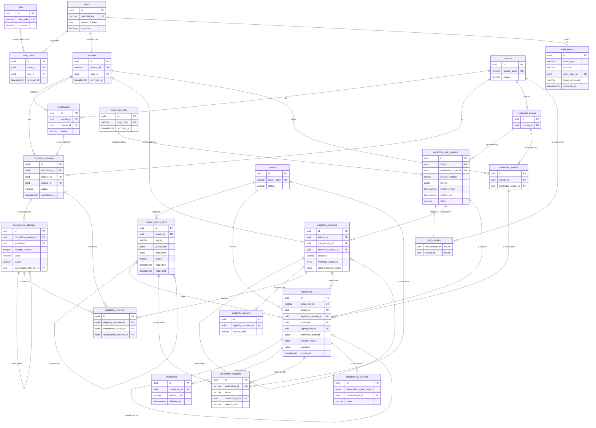

# Database Schema

Physical schema of the Credential Lifecycle Management System: **23 tables, 203 columns, 52 foreign keys, 30 check constraints, 61 indexes**, created by one Alembic revision (`af6e5dad6637`).

**How this document was produced.** The tables, columns, keys, constraints and indexes below were read from a PostgreSQL database after running `alembic upgrade head` on it, then compared with the SQLAlchemy models in `backend/app/models/domain.py` (same 23 tables, same columns; `alembic check` reports no difference). Descriptions were written against the services that use each table. The introspection ran on PostgreSQL 16.2; the project's Compose file uses PostgreSQL 17.

Related documents: [credential lifecycle](../credential-lifecycle.md), [security](../security.md), [API documentation](../api-documentation.md). The earlier design documents in this folder ([data dictionary](data-dictionary.md), [entity catalogue](entity-catalogue.md), [relationship specification](relationship-specification.md)) explain the reasoning behind the model; where they differ from this file, this file and the migration are correct.

## Contents

- [Conventions](#conventions)
- [Entity relationship diagram](#entity-relationship-diagram)
- [Table summary](#table-summary)
- [Relationships and cardinality](#relationships-and-cardinality)
- [Lifecycle and status fields](#lifecycle-and-status-fields)
- [Integrity rules worth knowing](#integrity-rules-worth-knowing)
- [Tables](#tables)
- [Migrations](#migrations)

## Conventions

| Convention | Detail |
|---|---|
| Primary keys | Every table has a `uuid` column `id`, generated by the application (`uuid4`), except `rule_courses`, whose key is `(rule_version_id, course_id)`. |
| Public identifiers | `learners.learner_id` (`LRN-NNNNNN`), `credentials.credential_id` (`CRD-YYYY-NNNNNN`), `verification_requests.verification_id` (`VER-YYYY-NNNNNN`). Each has a unique constraint and a format CHECK. |
| Timestamps | All are `timestamp with time zone` (`timestamptz`). Columns with a default use `now()`. |
| Binary data | Keys, digests, signatures and canonical payloads are `bytea`. Lengths are enforced by CHECK constraints (32 bytes for digests and public keys, 64 for signatures). |
| JSON | `jsonb`. |
| Deletes | Every foreign key is `ON DELETE RESTRICT`. Nothing cascades. The application has no delete operation. |
| Extensions and triggers | None. Only `plpgsql` is installed, and the schema defines no trigger, function, view or sequence. |
| Composite foreign keys | Several child tables repeat a parent's context columns and reference them together, for example `credentials (award_id, learner_id, credential_scope_id)`. This makes it impossible to attach a row to a parent that belongs to a different learner or scope. |

## Entity relationship diagram

The diagram shows keys and the columns that carry lifecycle meaning. Audit-actor foreign keys to `users` (for example `recorded_by_user_id`) are left out to keep it readable; they are listed under [Relationships and cardinality](#relationships-and-cardinality).



## Table summary

| Domain | Table | Rows describe | Columns | Foreign keys |
|---|---|---|---|---|
| Identity and access | [`users`](#users) | Login accounts | 6 | 0 |
| Identity and access | [`roles`](#roles) | Role codes | 4 | 0 |
| Identity and access | [`user_roles`](#user_roles) | Role grants | 7 | 4 |
| Academic records | [`learners`](#learners) | Learner profiles | 6 | 1 |
| Academic records | [`courses`](#courses) | Courses | 8 | 0 |
| Academic records | [`enrollments`](#enrollments) | Learner in a course | 9 | 3 |
| Academic records | [`completion_records`](#completion_records) | Completion state of an enrollment | 10 | 4 |
| Academic records | [`assessment_attempts`](#assessment_attempts) | Assessment attempts (all retries) | 14 | 4 |
| Rules and eligibility | [`credential_scopes`](#credential_scopes) | What a credential certifies (one course) | 3 | 1 |
| Rules and eligibility | [`credential_rules`](#credential_rules) | Rule identity | 6 | 0 |
| Rules and eligibility | [`credential_rule_versions`](#credential_rule_versions) | Immutable rule criteria | 11 | 3 |
| Rules and eligibility | [`rule_courses`](#rule_courses) | Courses a rule version requires | 3 | 2 |
| Rules and eligibility | [`eligibility_decisions`](#eligibility_decisions) | Evaluation results | 14 | 4 |
| Rules and eligibility | [`eligibility_reasons`](#eligibility_reasons) | Reason codes of a decision | 6 | 1 |
| Rules and eligibility | [`eligibility_evidence`](#eligibility_evidence) | Records a decision relied on | 9 | 5 |
| Issuer trust | [`issuers`](#issuers) | Issuing organisations | 6 | 0 |
| Issuer trust | [`issuer_signing_keys`](#issuer_signing_keys) | Public Ed25519 keys | 15 | 4 |
| Credential lifecycle | [`credential_awards`](#credential_awards) | Learner and scope award slot | 4 | 2 |
| Credential lifecycle | [`credentials`](#credentials) | Signed credentials | 16 | 6 |
| Credential lifecycle | [`revocations`](#revocations) | Revocation records | 9 | 2 |
| Credential lifecycle | [`verification_requests`](#verification_requests) | Verification calls | 17 | 4 |
| Credential lifecycle | [`idempotency_records`](#idempotency_records) | Issuance idempotency keys | 9 | 1 |
| Audit | [`audit_events`](#audit_events) | Append-only event log | 11 | 1 |

## Relationships and cardinality

Cardinality reads parent : child. `0..1` on the child side means the child's foreign key column is unique.

| Parent | Child | Cardinality | Meaning | Foreign key (child → parent) |
|---|---|---|---|---|
| `users` | `user_roles` | 1 : 0..n | users is granted user_roles | `(granted_by_user_id)` → `(id)`<br>`(revoked_by_user_id)` → `(id)`<br>`(user_id)` → `(id)` |
| `roles` | `user_roles` | 1 : 0..n | roles is assigned through user_roles | `(role_id)` → `(id)` |
| `users` | `learners` | 1 : 0..1 | users may log in as learners | `(user_id)` → `(id)` |
| `learners` | `enrollments` | 1 : 0..n | learners enrolls in enrollments | `(learner_id)` → `(id)` |
| `courses` | `enrollments` | 1 : 0..n | courses has enrollments | `(course_id)` → `(id)` |
| `enrollments` | `completion_records` | 1 : 0..1 | enrollments is completed by completion_records | `(enrollment_id, learner_id, course_id)` → `(id, learner_id, course_id)` |
| `learners` | `completion_records` | 1 : 0..n | learners has completion_records | `(learner_id)` → `(id)` |
| `courses` | `completion_records` | 1 : 0..n | courses has completion_records | `(course_id)` → `(id)` |
| `completion_records` | `assessment_attempts` | 1 : 0..n | completion_records is assessed by assessment_attempts | `(completion_record_id)` → `(id)`<br>`(completion_record_id, learner_id)` → `(id, learner_id)` |
| `assessment_attempts` | `assessment_attempts` | 1 : 0..n | assessment_attempts supersedes assessment_attempts | `(supersedes_attempt_id, completion_record_id)` → `(id, completion_record_id)` |
| `courses` | `credential_scopes` | 1 : 0..1 | courses defines credential_scopes | `(course_id)` → `(id)` |
| `credential_rules` | `credential_rule_versions` | 1 : 1..n | credential_rules is versioned as credential_rule_versions | `(rule_id)` → `(id)` |
| `credential_scopes` | `credential_rule_versions` | 1 : 0..n | credential_scopes is governed by credential_rule_versions | `(credential_scope_id)` → `(id)` |
| `credential_rule_versions` | `rule_courses` | 1 : 1..n | credential_rule_versions requires rule_courses | `(rule_version_id)` → `(id)` |
| `courses` | `rule_courses` | 1 : 0..n | courses is required by rule_courses | `(course_id)` → `(id)` |
| `learners` | `eligibility_decisions` | 1 : 0..n | learners is evaluated in eligibility_decisions | `(learner_id)` → `(id)` |
| `credential_rule_versions` | `eligibility_decisions` | 1 : 0..n | credential_rule_versions is applied in eligibility_decisions | `(rule_version_id, credential_scope_id)` → `(id, credential_scope_id)` |
| `eligibility_decisions` | `eligibility_decisions` | 1 : 0..n | eligibility_decisions supersedes eligibility_decisions | `(supersedes_decision_id)` → `(id)` |
| `eligibility_decisions` | `eligibility_reasons` | 1 : 0..n | eligibility_decisions explains with eligibility_reasons | `(eligibility_decision_id)` → `(id)` |
| `eligibility_decisions` | `eligibility_evidence` | 1 : 0..n | eligibility_decisions relies on eligibility_evidence | `(eligibility_decision_id, learner_id)` → `(id, learner_id)` |
| `completion_records` | `eligibility_evidence` | 1 : 0..n | completion_records is cited as eligibility_evidence | `(completion_record_id)` → `(id)`<br>`(completion_record_id, learner_id)` → `(id, learner_id)` |
| `assessment_attempts` | `eligibility_evidence` | 1 : 0..n | assessment_attempts is cited as eligibility_evidence | `(assessment_attempt_id)` → `(id)`<br>`(assessment_attempt_id, learner_id)` → `(id, learner_id)` |
| `issuers` | `issuer_signing_keys` | 1 : 0..n | issuers registers issuer_signing_keys | `(issuer_id)` → `(id)` |
| `issuer_signing_keys` | `issuer_signing_keys` | 1 : 0..n | issuer_signing_keys supersedes issuer_signing_keys | `(supersedes_key_id, issuer_id)` → `(id, issuer_id)` |
| `learners` | `credential_awards` | 1 : 0..n | learners holds credential_awards | `(learner_id)` → `(id)` |
| `credential_scopes` | `credential_awards` | 1 : 0..n | credential_scopes is awarded as credential_awards | `(credential_scope_id)` → `(id)` |
| `credential_awards` | `credentials` | 1 : 0..n | credential_awards is realised by credentials | `(award_id, learner_id, credential_scope_id)` → `(id, learner_id, credential_scope_id)` |
| `eligibility_decisions` | `credentials` | 1 : 0..1 | eligibility_decisions authorises credentials | `(eligibility_decision_id, learner_id, rule_version_id, credential_scope_id)` → `(id, learner_id, rule_version_id, credential_scope_id)` |
| `credential_rule_versions` | `credentials` | 1 : 0..n | credential_rule_versions is cited by credentials | `(rule_version_id)` → `(id)` |
| `issuers` | `credentials` | 1 : 0..n | issuers issues credentials | `(issuer_id)` → `(id)` |
| `issuer_signing_keys` | `credentials` | 1 : 0..n | issuer_signing_keys signs credentials | `(signing_key_id, issuer_id)` → `(id, issuer_id)` |
| `credentials` | `credentials` | 1 : 0..1 | credentials is replaced by credentials | `(replacement_of_credential_id, award_id)` → `(id, award_id)` |
| `credentials` | `revocations` | 1 : 0..1 | credentials is revoked by revocations | `(credential_id)` → `(id)` |
| `credentials` | `verification_requests` | 1 : 0..n | credentials is checked in verification_requests | `(credential_id_fk)` → `(id)` |
| `issuers` | `verification_requests` | 1 : 0..n | issuers is resolved in verification_requests | `(resolved_issuer_id)` → `(id)` |
| `issuer_signing_keys` | `verification_requests` | 1 : 0..n | issuer_signing_keys is resolved in verification_requests | `(resolved_signing_key_id)` → `(id)` |
| `credentials` | `idempotency_records` | 1 : 0..n | credentials is the result of idempotency_records | `(credential_id_fk)` → `(id)` |

**Notes on cardinality**

- `credential_rules` → `credential_rule_versions` and `credential_rule_versions` → `rule_courses` are shown as `1..n` because the API always creates the first version and its course row in the same transaction. The database itself does not require a child row.
- `credential_awards` → `credentials` is `0..n` in the schema to allow a replacement chain, but the partial unique index `uq_credentials_one_root_per_award` allows only one credential per award that is not a replacement. No API creates a replacement, so in practice each award has at most one credential.
- `enrollments`: one *active* enrollment per learner and course is enforced by the service (`409`), not by a constraint.

**Actor references.** These nullable foreign keys to `users.id` record who performed an action. Each is `users` 1 : 0..n child.

| Child table | Column(s) |
|---|---|
| `assessment_attempts` | `recorded_by_user_id` |
| `audit_events` | `actor_user_id` |
| `completion_records` | `recorded_by_user_id` |
| `credential_rule_versions` | `created_by_user_id` |
| `eligibility_decisions` | `evaluator_user_id` |
| `enrollments` | `recorded_by_user_id` |
| `issuer_signing_keys` | `approved_by_user_id`, `registered_by_user_id` |
| `revocations` | `recorded_by_user_id` |
| `verification_requests` | `requester_user_id` |
| `user_roles` | `granted_by_user_id`, `revoked_by_user_id` (in addition to `user_id`) |

## Lifecycle and status fields

Most status vocabularies are enforced by the service layer, not by the database. Only `eligibility_decisions.outcome` and `eligibility_decisions.evaluator_type` have CHECK constraints on their values. A script that writes to the database directly can therefore store a status the API would reject.

| Table | Field(s) | Values | Enforced by | Changed by |
|---|---|---|---|---|
| `users` | `is_active` | `true`, `false` | Checked by `get_current_user` and login | No API changes it |
| `user_roles` | `revoked_at` | null = active grant | Partial unique index `uq_user_roles_active_user_role` | No API changes it |
| `learners` | `archived_at` | null = active | Services (`404 Active learner was not found.`) | `PATCH /learners/{id}` with `archived` |
| `courses` | `status` | `active`, `inactive`, `archived` | Service only (no CHECK constraint) | `POST`, `PATCH /courses` |
| `enrollments` | `status` | `active` on creation; `cancelled` is recognised when read | Service only | No API sets `cancelled` |
| `completion_records` | `status` | `in_progress`, `completed`, `incomplete`, `failed` | Service only | `POST`, `PATCH /completions` |
| `assessment_attempts` | `status` | `submitted`, `graded`, `voided` | Service only | `POST /assessment-attempts` (insert only) |
| `credential_rules` | `archived_at` | null = active | Services | No API changes it |
| `credential_rule_versions` | `status, effective_from, effective_to` | `active` on creation; a version applies while `effective_from <= now < effective_to` | Service; CHECK on the period | `POST /credential-rules/{code}/versions` closes the previous period |
| `eligibility_decisions` | `outcome` | `eligible`, `ineligible`, `needs_review` | **CHECK `ck_decisions_outcome`** | Insert only |
| `issuers` | `status, archived_at` | `active`, `suspended`, `archived` | Service only | `PATCH /issuers/{code}` |
| `issuer_signing_keys` | `status, valid_from, valid_until, revoked_at` | `active`, `retired` (after rotation), `revoked` | Service only; CHECK on the validity period | Register (with `supersedes_key_id`) and revoke routes |
| `credentials` | `(derived)` | `active` or `revoked`, derived from `revocations.effective_at <= now` | Query logic in services and reports | `POST /revocations/{credential_id}` |
| `verification_requests` | `overall_result` | `VALID`, `REVOKED`, `NOT_FOUND`, `INVALID_SIGNATURE`, `TAMPERED`, `UNVERIFIABLE` | Service only | Insert only |
| `idempotency_records` | `state, expires_at` | `in_progress`, `completed`, `failed`; 24-hour window | Service; CHECK `expires_at > created_at` | Issuance |

State diagrams for these fields are in [credential-lifecycle.md](../credential-lifecycle.md#state-transitions).

## Integrity rules worth knowing

| Rule | How the database enforces it |
|---|---|
| One credential per learner and course | `credential_awards` unique `(learner_id, credential_scope_id)` plus partial unique index `uq_credentials_one_root_per_award` on `credentials (award_id) WHERE replacement_of_credential_id IS NULL` |
| A credential cites exactly the decision that authorised it | Composite foreign key `credentials (eligibility_decision_id, learner_id, rule_version_id, credential_scope_id)` → `eligibility_decisions`, and unique `uq_credentials_decision` (a decision can authorise one credential) |
| A credential is signed by a key of its own issuer | Composite foreign key `credentials (signing_key_id, issuer_id)` → `issuer_signing_keys (id, issuer_id)` |
| Every credential is signed with Ed25519 | `ck_credentials_signature_format` (algorithm is `Ed25519`, signature is 64 bytes), `ck_credentials_digest_length` (32 bytes) |
| A credential is revoked at most once | Unique `uq_revocations_credential` |
| A user holds a role at most once at a time | Partial unique index `uq_user_roles_active_user_role` on `(user_id, role_id) WHERE revoked_at IS NULL` |
| An attempt belongs to the learner of its completion record | Composite foreign key `assessment_attempts (completion_record_id, learner_id)` → `completion_records (id, learner_id)` |
| Evidence cites one source | `ck_evidence_exactly_one_source` |
| Only public keys of the right size are stored | `ck_issuer_keys_public_material_length`, `ck_issuer_keys_algorithm` |
| Idempotency keys are unique per caller and operation | Unique `uq_idempotency_scope_key` on `(principal_key, operation, idempotency_key_digest)` |

**Not enforced by the database:** immutability of `audit_events`, `eligibility_decisions`, `credentials` and `revocations`. The application never updates or deletes these rows, but there is no trigger or revoked privilege that would stop a database user from doing so.

## Tables

### Identity and access

#### `users`

Login accounts. `password_hash` holds a PBKDF2-HMAC-SHA256 hash string; no plaintext password is stored. `is_active = false` blocks login and every token.

| Column | Type | Null | Default | Key |
|---|---|---|---|---|
| `id` | uuid | no |  | PK |
| `principal_key` | varchar(200) | no |  | unique |
| `password_hash` | text | yes |  |  |
| `display_name` | varchar(200) | yes |  |  |
| `is_active` | boolean | no |  |  |
| `created_at` | timestamptz | no | `now()` |  |

Unique constraints:

- `users_principal_key_key`: `(principal_key)`

Indexes: the primary key and one index per unique constraint above.

#### `roles`

Role catalogue. Rows are created on demand by `backend/scripts/bootstrap_demo_user.py`; the migration does not seed roles.

| Column | Type | Null | Default | Key |
|---|---|---|---|---|
| `id` | uuid | no |  | PK |
| `role_code` | varchar(64) | no |  | unique |
| `description` | text | yes |  |  |
| `is_active` | boolean | no |  |  |

Unique constraints:

- `roles_role_code_key`: `(role_code)`

Indexes: the primary key and one index per unique constraint above.

#### `user_roles`

Role grants. A grant is active while `revoked_at` is null. Authorization reads active grants on every request.

| Column | Type | Null | Default | Key |
|---|---|---|---|---|
| `id` | uuid | no |  | PK |
| `user_id` | uuid | no |  | FK → `users` |
| `role_id` | uuid | no |  | FK → `roles` |
| `granted_at` | timestamptz | no | `now()` |  |
| `granted_by_user_id` | uuid | yes |  | FK → `users` |
| `revoked_at` | timestamptz | yes |  |  |
| `revoked_by_user_id` | uuid | yes |  | FK → `users` |

Foreign keys (all `ON DELETE RESTRICT`):

- `user_roles_granted_by_user_id_fkey`: `(granted_by_user_id)` → `users (id)`
- `user_roles_revoked_by_user_id_fkey`: `(revoked_by_user_id)` → `users (id)`
- `user_roles_role_id_fkey`: `(role_id)` → `roles (id)`
- `user_roles_user_id_fkey`: `(user_id)` → `users (id)`

Check constraints:

- `ck_user_roles_revocation_after_grant`: `revoked_at IS NULL OR revoked_at >= granted_at`

Additional indexes:

- `uq_user_roles_active_user_role` (unique, partial): `(user_id, role_id) WHERE (revoked_at IS NULL)`

### Academic records

#### `learners`

Learner profiles. `learner_id` is the public `LRN-NNNNNN` identifier. `user_id` optionally links a login account (used by `GET /learners/me/credentials`).

| Column | Type | Null | Default | Key |
|---|---|---|---|---|
| `id` | uuid | no |  | PK |
| `learner_id` | varchar(10) | no |  | unique |
| `display_name` | varchar(200) | no |  |  |
| `user_id` | uuid | yes |  | FK → `users`; unique |
| `archived_at` | timestamptz | yes |  |  |
| `created_at` | timestamptz | no | `now()` |  |

Foreign keys (all `ON DELETE RESTRICT`):

- `learners_user_id_fkey`: `(user_id)` → `users (id)`

Unique constraints:

- `learners_learner_id_key`: `(learner_id)`
- `learners_user_id_key`: `(user_id)`

Check constraints:

- `ck_learners_external_id_format`: `learner_id ~ '^LRN-[0-9]{6}$'`
- `ck_learners_name_nonempty`: `length(TRIM(BOTH FROM display_name)) > 0`

Indexes: the primary key and one index per unique constraint above.

#### `courses`

Course catalogue. Rules and enrollments require a course with status `active`.

| Column | Type | Null | Default | Key |
|---|---|---|---|---|
| `id` | uuid | no |  | PK |
| `course_code` | varchar(64) | no |  | unique |
| `title` | varchar(200) | no |  |  |
| `description` | text | yes |  |  |
| `status` | varchar(24) | no |  |  |
| `effective_from` | timestamptz | yes |  |  |
| `effective_to` | timestamptz | yes |  |  |
| `created_at` | timestamptz | no | `now()` |  |

Unique constraints:

- `courses_course_code_key`: `(course_code)`

Check constraints:

- `ck_courses_effective_period`: `effective_to IS NULL OR effective_from IS NULL OR effective_to > effective_from`

Indexes: the primary key and one index per unique constraint above.

#### `enrollments`

A learner's enrollment in a course. Eligibility needs an enrollment whose status is not `cancelled`.

| Column | Type | Null | Default | Key |
|---|---|---|---|---|
| `id` | uuid | no |  | PK |
| `learner_id` | uuid | no |  | FK → `learners` |
| `course_id` | uuid | no |  | FK → `courses` |
| `status` | varchar(24) | no |  |  |
| `enrolled_at` | timestamptz | no | `now()` |  |
| `effective_from` | timestamptz | yes |  |  |
| `effective_to` | timestamptz | yes |  |  |
| `recorded_by_user_id` | uuid | yes |  | FK → `users` |
| `created_at` | timestamptz | no | `now()` |  |

Foreign keys (all `ON DELETE RESTRICT`):

- `enrollments_course_id_fkey`: `(course_id)` → `courses (id)`
- `enrollments_learner_id_fkey`: `(learner_id)` → `learners (id)`
- `enrollments_recorded_by_user_id_fkey`: `(recorded_by_user_id)` → `users (id)`

Unique constraints:

- `uq_enrollments_context`: `(id, learner_id, course_id)`

Check constraints:

- `ck_enrollments_effective_period`: `effective_to IS NULL OR effective_from IS NULL OR effective_to > effective_from`

Indexes: the primary key and one index per unique constraint above.

#### `completion_records`

Completion state of one enrollment. At most one row per enrollment.

| Column | Type | Null | Default | Key |
|---|---|---|---|---|
| `id` | uuid | no |  | PK |
| `learner_id` | uuid | no |  | FK → `enrollments`, `learners` |
| `course_id` | uuid | no |  | FK → `courses`, `enrollments` |
| `enrollment_id` | uuid | yes |  | FK → `enrollments`; unique |
| `status` | varchar(24) | no |  |  |
| `started_at` | timestamptz | yes |  |  |
| `completed_at` | timestamptz | yes |  |  |
| `recorded_at` | timestamptz | no | `now()` |  |
| `recorded_by_user_id` | uuid | yes |  | FK → `users` |
| `source_reference` | varchar(200) | yes |  |  |

Foreign keys (all `ON DELETE RESTRICT`):

- `completion_records_course_id_fkey`: `(course_id)` → `courses (id)`
- `completion_records_learner_id_fkey`: `(learner_id)` → `learners (id)`
- `completion_records_recorded_by_user_id_fkey`: `(recorded_by_user_id)` → `users (id)`
- `fk_completions_enrollment_context`: `(enrollment_id, learner_id, course_id)` → `enrollments (id, learner_id, course_id)`

Unique constraints:

- `uq_completions_enrollment`: `(enrollment_id)`
- `uq_completions_id_learner`: `(id, learner_id)`

Check constraints:

- `ck_completions_parent_context`: `enrollment_id IS NOT NULL OR learner_id IS NOT NULL AND course_id IS NOT NULL`
- `ck_completions_time_order`: `completed_at IS NULL OR started_at IS NULL OR completed_at >= started_at`

Indexes: the primary key and one index per unique constraint above.

#### `assessment_attempts`

Every assessment attempt, including retries. Rows are never updated or collapsed; a correction is a new row that points at the old one through `supersedes_attempt_id`.

| Column | Type | Null | Default | Key |
|---|---|---|---|---|
| `id` | uuid | no |  | PK |
| `completion_record_id` | uuid | no |  | FK → `assessment_attempts`, `completion_records` |
| `learner_id` | uuid | no |  | FK → `completion_records` |
| `assessment_key` | varchar(100) | no |  |  |
| `attempt_number` | integer | no |  |  |
| `score` | numeric(10,4) | yes |  |  |
| `score_scale` | varchar(40) | yes |  |  |
| `result_code` | varchar(32) | yes |  |  |
| `status` | varchar(24) | no |  |  |
| `submitted_at` | timestamptz | no |  |  |
| `graded_at` | timestamptz | yes |  |  |
| `recorded_at` | timestamptz | no | `now()` |  |
| `recorded_by_user_id` | uuid | yes |  | FK → `users` |
| `supersedes_attempt_id` | uuid | yes |  | FK → `assessment_attempts` |

Foreign keys (all `ON DELETE RESTRICT`):

- `assessment_attempts_completion_record_id_fkey`: `(completion_record_id)` → `completion_records (id)`
- `assessment_attempts_recorded_by_user_id_fkey`: `(recorded_by_user_id)` → `users (id)`
- `fk_attempts_completion_learner`: `(completion_record_id, learner_id)` → `completion_records (id, learner_id)`
- `fk_attempts_superseded_same_completion`: `(supersedes_attempt_id, completion_record_id)` → `assessment_attempts (id, completion_record_id)`

Unique constraints:

- `uq_attempts_completion_context`: `(id, completion_record_id)`
- `uq_attempts_id_learner`: `(id, learner_id)`
- `uq_attempts_sequence`: `(completion_record_id, assessment_key, attempt_number)`

Check constraints:

- `ck_attempts_positive_number`: `attempt_number > 0`
- `ck_attempts_score_scale`: `score IS NULL OR score_scale IS NOT NULL`
- `ck_attempts_time_order`: `graded_at IS NULL OR graded_at >= submitted_at`

Indexes: the primary key and one index per unique constraint above.

### Rules and eligibility

#### `credential_scopes`

The thing a credential certifies. In this release a scope is exactly one course (`course_id` is unique).

| Column | Type | Null | Default | Key |
|---|---|---|---|---|
| `id` | uuid | no |  | PK |
| `course_id` | uuid | no |  | FK → `courses`; unique |
| `created_at` | timestamptz | no | `now()` |  |

Foreign keys (all `ON DELETE RESTRICT`):

- `credential_scopes_course_id_fkey`: `(course_id)` → `courses (id)`

Unique constraints:

- `credential_scopes_course_id_key`: `(course_id)`

Indexes: the primary key and one index per unique constraint above.

#### `credential_rules`

Rule identity (`rule_code`, name). The criteria live in versions.

| Column | Type | Null | Default | Key |
|---|---|---|---|---|
| `id` | uuid | no |  | PK |
| `rule_code` | varchar(64) | no |  | unique |
| `name` | varchar(200) | no |  |  |
| `description` | text | yes |  |  |
| `archived_at` | timestamptz | yes |  |  |
| `created_at` | timestamptz | no | `now()` |  |

Unique constraints:

- `credential_rules_rule_code_key`: `(rule_code)`

Indexes: the primary key and one index per unique constraint above.

#### `credential_rule_versions`

Immutable rule versions. `criteria` is a JSON object with `requires_completion`, `minimum_score`, `score_scale`, `attempt_selection_policy`.

| Column | Type | Null | Default | Key |
|---|---|---|---|---|
| `id` | uuid | no |  | PK |
| `rule_id` | uuid | no |  | FK → `credential_rules` |
| `version_number` | integer | no |  |  |
| `credential_scope_id` | uuid | no |  | FK → `credential_scopes` |
| `criteria` | jsonb | no |  |  |
| `attempt_selection_policy` | varchar(24) | yes |  |  |
| `effective_from` | timestamptz | no |  |  |
| `effective_to` | timestamptz | yes |  |  |
| `status` | varchar(24) | no |  |  |
| `created_by_user_id` | uuid | yes |  | FK → `users` |
| `created_at` | timestamptz | no | `now()` |  |

Foreign keys (all `ON DELETE RESTRICT`):

- `credential_rule_versions_created_by_user_id_fkey`: `(created_by_user_id)` → `users (id)`
- `credential_rule_versions_credential_scope_id_fkey`: `(credential_scope_id)` → `credential_scopes (id)`
- `credential_rule_versions_rule_id_fkey`: `(rule_id)` → `credential_rules (id)`

Unique constraints:

- `uq_rule_versions_id_scope`: `(id, credential_scope_id)`
- `uq_rule_versions_number`: `(rule_id, version_number)`

Check constraints:

- `ck_rule_versions_criteria_object`: `jsonb_typeof(criteria) = 'object'`
- `ck_rule_versions_effective_period`: `effective_to IS NULL OR effective_to > effective_from`
- `ck_rule_versions_positive_number`: `version_number > 0`

Indexes: the primary key and one index per unique constraint above.

#### `rule_courses`

Courses a rule version requires. The API writes exactly one row per version.

| Column | Type | Null | Default | Key |
|---|---|---|---|---|
| `rule_version_id` | uuid | no |  | PK; FK → `credential_rule_versions` |
| `course_id` | uuid | no |  | PK; FK → `courses` |
| `created_at` | timestamptz | no | `now()` |  |

Foreign keys (all `ON DELETE RESTRICT`):

- `rule_courses_course_id_fkey`: `(course_id)` → `courses (id)`
- `rule_courses_rule_version_id_fkey`: `(rule_version_id)` → `credential_rule_versions (id)`

Indexes: the primary key.

#### `eligibility_decisions`

Immutable result of one eligibility evaluation, with the evidence snapshot and its SHA-256 digest. A new evaluation inserts a new row.

| Column | Type | Null | Default | Key |
|---|---|---|---|---|
| `id` | uuid | no |  | PK |
| `learner_id` | uuid | no |  | FK → `learners` |
| `rule_version_id` | uuid | no |  | FK → `credential_rule_versions` |
| `credential_scope_id` | uuid | no |  | FK → `credential_rule_versions` |
| `evaluated_at` | timestamptz | no | `now()` |  |
| `outcome` | varchar(24) | no |  |  |
| `evaluator_type` | varchar(24) | no |  |  |
| `evaluator_user_id` | uuid | yes |  | FK → `users` |
| `evaluator_reference` | varchar(200) | yes |  |  |
| `evaluator_version` | varchar(40) | no |  |  |
| `attempt_selection_policy` | varchar(24) | yes |  |  |
| `evidence_snapshot` | jsonb | no |  |  |
| `input_snapshot_digest` | bytea | no |  |  |
| `supersedes_decision_id` | uuid | yes |  | FK → `eligibility_decisions` |

Foreign keys (all `ON DELETE RESTRICT`):

- `eligibility_decisions_evaluator_user_id_fkey`: `(evaluator_user_id)` → `users (id)`
- `eligibility_decisions_learner_id_fkey`: `(learner_id)` → `learners (id)`
- `eligibility_decisions_supersedes_decision_id_fkey`: `(supersedes_decision_id)` → `eligibility_decisions (id)`
- `fk_decisions_rule_scope`: `(rule_version_id, credential_scope_id)` → `credential_rule_versions (id, credential_scope_id)`

Unique constraints:

- `uq_decisions_id_learner`: `(id, learner_id)`
- `uq_decisions_issuance_context`: `(id, learner_id, rule_version_id, credential_scope_id)`

Check constraints:

- `ck_decisions_digest_length`: `input_snapshot_digest IS NULL OR octet_length(input_snapshot_digest) = 32`
- `ck_decisions_evaluator_type`: `evaluator_type = ANY (ARRAY['user', 'service'][])`
- `ck_decisions_outcome`: `outcome = ANY (ARRAY['eligible', 'ineligible', 'needs_review'][])`

Indexes: the primary key and one index per unique constraint above.

#### `eligibility_reasons`

Reason codes of a decision, one row per code.

| Column | Type | Null | Default | Key |
|---|---|---|---|---|
| `id` | uuid | no |  | PK |
| `eligibility_decision_id` | uuid | no |  | FK → `eligibility_decisions` |
| `reason_code` | varchar(64) | no |  |  |
| `message` | text | yes |  |  |
| `details` | jsonb | yes |  |  |
| `created_at` | timestamptz | no | `now()` |  |

Foreign keys (all `ON DELETE RESTRICT`):

- `eligibility_reasons_eligibility_decision_id_fkey`: `(eligibility_decision_id)` → `eligibility_decisions (id)`

Indexes: the primary key.

#### `eligibility_evidence`

The completion record or assessment attempt a decision relied on. Exactly one of the two source columns is set.

| Column | Type | Null | Default | Key |
|---|---|---|---|---|
| `id` | uuid | no |  | PK |
| `eligibility_decision_id` | uuid | no |  | FK → `eligibility_decisions` |
| `learner_id` | uuid | no |  | FK → `assessment_attempts`, `completion_records`, `eligibility_decisions` |
| `completion_record_id` | uuid | yes |  | FK → `completion_records` |
| `assessment_attempt_id` | uuid | yes |  | FK → `assessment_attempts` |
| `selection_role` | varchar(24) | no |  |  |
| `evidence_snapshot` | jsonb | no |  |  |
| `evidence_digest` | bytea | no |  |  |
| `captured_at` | timestamptz | no | `now()` |  |

Foreign keys (all `ON DELETE RESTRICT`):

- `eligibility_evidence_assessment_attempt_id_fkey`: `(assessment_attempt_id)` → `assessment_attempts (id)`
- `eligibility_evidence_completion_record_id_fkey`: `(completion_record_id)` → `completion_records (id)`
- `fk_evidence_attempt_learner`: `(assessment_attempt_id, learner_id)` → `assessment_attempts (id, learner_id)`
- `fk_evidence_completion_learner`: `(completion_record_id, learner_id)` → `completion_records (id, learner_id)`
- `fk_evidence_decision_learner`: `(eligibility_decision_id, learner_id)` → `eligibility_decisions (id, learner_id)`

Check constraints:

- `ck_evidence_exactly_one_source`: `completion_record_id IS NOT NULL AND assessment_attempt_id IS NULL OR completion_record_id IS NULL AND assessment_attempt_id IS NOT NULL`

Indexes: the primary key.

### Issuer trust

#### `issuers`

Organisations that issue credentials.

| Column | Type | Null | Default | Key |
|---|---|---|---|---|
| `id` | uuid | no |  | PK |
| `issuer_code` | varchar(64) | no |  | unique |
| `name` | varchar(200) | no |  |  |
| `status` | varchar(24) | no |  |  |
| `archived_at` | timestamptz | yes |  |  |
| `created_at` | timestamptz | no | `now()` |  |

Unique constraints:

- `issuers_issuer_code_key`: `(issuer_code)`

Indexes: the primary key and one index per unique constraint above.

#### `issuer_signing_keys`

**Public** Ed25519 keys only (32 raw bytes) with their SHA-256 fingerprint. No private key column exists anywhere in the schema.

| Column | Type | Null | Default | Key |
|---|---|---|---|---|
| `id` | uuid | no |  | PK |
| `issuer_id` | uuid | no |  | FK → `issuer_signing_keys`, `issuers` |
| `key_id` | varchar(128) | no |  |  |
| `public_key` | bytea | no |  |  |
| `fingerprint` | bytea | no |  |  |
| `algorithm` | varchar(40) | no |  |  |
| `key_purpose` | varchar(32) | no |  |  |
| `valid_from` | timestamptz | no |  |  |
| `valid_until` | timestamptz | yes |  |  |
| `status` | varchar(24) | no |  |  |
| `supersedes_key_id` | uuid | yes |  | FK → `issuer_signing_keys` |
| `registered_by_user_id` | uuid | yes |  | FK → `users` |
| `approved_by_user_id` | uuid | yes |  | FK → `users` |
| `registered_at` | timestamptz | no | `now()` |  |
| `revoked_at` | timestamptz | yes |  |  |

Foreign keys (all `ON DELETE RESTRICT`):

- `fk_issuer_keys_rotation_same_issuer`: `(supersedes_key_id, issuer_id)` → `issuer_signing_keys (id, issuer_id)`
- `issuer_signing_keys_approved_by_user_id_fkey`: `(approved_by_user_id)` → `users (id)`
- `issuer_signing_keys_issuer_id_fkey`: `(issuer_id)` → `issuers (id)`
- `issuer_signing_keys_registered_by_user_id_fkey`: `(registered_by_user_id)` → `users (id)`

Unique constraints:

- `uq_issuer_keys_fingerprint`: `(issuer_id, fingerprint)`
- `uq_issuer_keys_id_issuer`: `(id, issuer_id)`
- `uq_issuer_keys_issuer_key`: `(issuer_id, key_id)`

Check constraints:

- `ck_issuer_keys_algorithm`: `algorithm = 'Ed25519'`
- `ck_issuer_keys_public_material_length`: `octet_length(public_key) = 32 AND octet_length(fingerprint) = 32`
- `ck_issuer_keys_validity`: `valid_until IS NULL OR valid_until > valid_from`

Indexes: the primary key and one index per unique constraint above.

### Credential lifecycle

#### `credential_awards`

The award slot: one row per learner and credential scope. It is what prevents a second credential for the same learner and course.

| Column | Type | Null | Default | Key |
|---|---|---|---|---|
| `id` | uuid | no |  | PK |
| `learner_id` | uuid | no |  | FK → `learners` |
| `credential_scope_id` | uuid | no |  | FK → `credential_scopes` |
| `created_at` | timestamptz | no | `now()` |  |

Foreign keys (all `ON DELETE RESTRICT`):

- `credential_awards_credential_scope_id_fkey`: `(credential_scope_id)` → `credential_scopes (id)`
- `credential_awards_learner_id_fkey`: `(learner_id)` → `learners (id)`

Unique constraints:

- `uq_awards_context`: `(id, learner_id, credential_scope_id)`
- `uq_awards_learner_scope`: `(learner_id, credential_scope_id)`

Indexes: the primary key and one index per unique constraint above.

#### `credentials`

Issued credentials: the canonical payload bytes, their SHA-256 digest, the Ed25519 signature, and the key that signed them. There is **no status column**; a credential is revoked when a `revocations` row exists with `effective_at` in the past.

| Column | Type | Null | Default | Key |
|---|---|---|---|---|
| `id` | uuid | no |  | PK |
| `credential_id` | varchar(15) | no |  | unique |
| `award_id` | uuid | no |  | FK → `credential_awards`, `credentials` |
| `learner_id` | uuid | no |  | FK → `credential_awards`, `eligibility_decisions` |
| `credential_scope_id` | uuid | no |  | FK → `credential_awards`, `eligibility_decisions` |
| `issuer_id` | uuid | no |  | FK → `issuer_signing_keys`, `issuers` |
| `rule_version_id` | uuid | no |  | FK → `credential_rule_versions`, `eligibility_decisions` |
| `eligibility_decision_id` | uuid | no |  | FK → `eligibility_decisions`; unique |
| `replacement_of_credential_id` | uuid | yes |  | FK → `credentials`; unique |
| `issued_at` | timestamptz | no | `now()` |  |
| `payload_version` | varchar(32) | no |  |  |
| `canonical_payload` | bytea | no |  |  |
| `sha256_digest` | bytea | no |  |  |
| `signature` | bytea | no |  |  |
| `signature_algorithm` | varchar(40) | no |  |  |
| `signing_key_id` | uuid | no |  | FK → `issuer_signing_keys` |

Foreign keys (all `ON DELETE RESTRICT`):

- `credentials_issuer_id_fkey`: `(issuer_id)` → `issuers (id)`
- `credentials_rule_version_id_fkey`: `(rule_version_id)` → `credential_rule_versions (id)`
- `fk_credentials_award_context`: `(award_id, learner_id, credential_scope_id)` → `credential_awards (id, learner_id, credential_scope_id)`
- `fk_credentials_decision_context`: `(eligibility_decision_id, learner_id, rule_version_id, credential_scope_id)` → `eligibility_decisions (id, learner_id, rule_version_id, credential_scope_id)`
- `fk_credentials_replacement_same_award`: `(replacement_of_credential_id, award_id)` → `credentials (id, award_id)`
- `fk_credentials_signing_key_issuer`: `(signing_key_id, issuer_id)` → `issuer_signing_keys (id, issuer_id)`

Unique constraints:

- `uq_credentials_decision`: `(eligibility_decision_id)`
- `uq_credentials_external_id`: `(credential_id)`
- `uq_credentials_id_award`: `(id, award_id)`
- `uq_credentials_one_successor`: `(replacement_of_credential_id)`

Check constraints:

- `ck_credentials_decision_required`: `replacement_of_credential_id IS NOT NULL OR eligibility_decision_id IS NOT NULL`
- `ck_credentials_digest_length`: `octet_length(sha256_digest) = 32`
- `ck_credentials_external_id_format`: `credential_id ~ '^CRD-[0-9]{4}-[0-9]{6}$'`
- `ck_credentials_signature_fields`: `signature IS NOT NULL AND signature_algorithm IS NOT NULL AND signing_key_id IS NOT NULL`
- `ck_credentials_signature_format`: `signature_algorithm = 'Ed25519' AND octet_length(signature) = 64`

Additional indexes:

- `ix_credentials_issuer_id` (non-unique): `(issuer_id)`
- `ix_credentials_learner_scope` (non-unique): `(learner_id, credential_scope_id)`
- `uq_credentials_one_root_per_award` (unique, partial): `(award_id) WHERE (replacement_of_credential_id IS NULL)`

#### `revocations`

Revocation records. At most one per credential. The credential row is never deleted or changed.

| Column | Type | Null | Default | Key |
|---|---|---|---|---|
| `id` | uuid | no |  | PK |
| `credential_id` | uuid | no |  | FK → `credentials`; unique |
| `reason_code` | varchar(64) | no |  |  |
| `reason_detail` | text | yes |  |  |
| `recorded_by_user_id` | uuid | yes |  | FK → `users` |
| `actor_reference` | varchar(200) | no |  |  |
| `effective_at` | timestamptz | no |  |  |
| `recorded_at` | timestamptz | no | `now()` |  |
| `correlation_id` | uuid | yes |  |  |

Foreign keys (all `ON DELETE RESTRICT`):

- `revocations_credential_id_fkey`: `(credential_id)` → `credentials (id)`
- `revocations_recorded_by_user_id_fkey`: `(recorded_by_user_id)` → `users (id)`

Unique constraints:

- `uq_revocations_credential`: `(credential_id)`

Indexes: the primary key and one index per unique constraint above.

#### `verification_requests`

One row per verification call (`VER-YYYY-NNNNNN`), with the three partial results and the overall result. Stores no learner data and no requester network address.

| Column | Type | Null | Default | Key |
|---|---|---|---|---|
| `id` | uuid | no |  | PK |
| `verification_id` | varchar(15) | no |  | unique |
| `mode` | varchar(24) | no |  |  |
| `submitted_credential_id` | varchar(15) | yes |  |  |
| `credential_id_fk` | uuid | yes |  | FK → `credentials` |
| `resolved_issuer_id` | uuid | yes |  | FK → `issuers` |
| `resolved_signing_key_id` | uuid | yes |  | FK → `issuer_signing_keys` |
| `input_digest` | bytea | yes |  |  |
| `integrity_result` | varchar(24) | no |  |  |
| `issuer_trust_result` | varchar(24) | no |  |  |
| `lifecycle_result` | varchar(24) | no |  |  |
| `overall_result` | varchar(32) | no |  |  |
| `requester_user_id` | uuid | yes |  | FK → `users` |
| `requester_reference` | varchar(200) | yes |  |  |
| `requested_at` | timestamptz | no | `now()` |  |
| `completed_at` | timestamptz | yes |  |  |
| `correlation_id` | uuid | yes |  |  |

Foreign keys (all `ON DELETE RESTRICT`):

- `verification_requests_credential_id_fk_fkey`: `(credential_id_fk)` → `credentials (id)`
- `verification_requests_requester_user_id_fkey`: `(requester_user_id)` → `users (id)`
- `verification_requests_resolved_issuer_id_fkey`: `(resolved_issuer_id)` → `issuers (id)`
- `verification_requests_resolved_signing_key_id_fkey`: `(resolved_signing_key_id)` → `issuer_signing_keys (id)`

Unique constraints:

- `verification_requests_verification_id_key`: `(verification_id)`

Check constraints:

- `ck_verifications_digest_length`: `input_digest IS NULL OR octet_length(input_digest) = 32`
- `ck_verifications_external_id_format`: `verification_id ~ '^VER-[0-9]{4}-[0-9]{6}$'`
- `ck_verifications_time_order`: `completed_at IS NULL OR completed_at >= requested_at`

Additional indexes:

- `ix_verifications_credential_requested` (non-unique): `(credential_id_fk, requested_at)`

#### `idempotency_records`

Issuance idempotency keys. Stores the SHA-256 of the key and of the request, never the key itself.

| Column | Type | Null | Default | Key |
|---|---|---|---|---|
| `id` | uuid | no |  | PK |
| `principal_key` | varchar(200) | no |  |  |
| `operation` | varchar(100) | no |  |  |
| `idempotency_key_digest` | bytea | no |  |  |
| `request_fingerprint` | bytea | no |  |  |
| `credential_id_fk` | uuid | yes |  | FK → `credentials` |
| `state` | varchar(24) | no |  |  |
| `created_at` | timestamptz | no | `now()` |  |
| `expires_at` | timestamptz | no |  |  |

Foreign keys (all `ON DELETE RESTRICT`):

- `idempotency_records_credential_id_fk_fkey`: `(credential_id_fk)` → `credentials (id)`

Unique constraints:

- `uq_idempotency_scope_key`: `(principal_key, operation, idempotency_key_digest)`

Check constraints:

- `ck_idempotency_digest_lengths`: `octet_length(idempotency_key_digest) = 32 AND octet_length(request_fingerprint) = 32`
- `ck_idempotency_expiry`: `expires_at > created_at`

Indexes: the primary key and one index per unique constraint above.

### Audit

#### `audit_events`

Append-only event log written in the same transaction as the change it describes.

| Column | Type | Null | Default | Key |
|---|---|---|---|---|
| `id` | uuid | no |  | PK |
| `event_type` | varchar(100) | no |  |  |
| `outcome` | varchar(24) | no |  |  |
| `actor_user_id` | uuid | yes |  | FK → `users` |
| `actor_reference` | varchar(200) | no |  |  |
| `target_type` | varchar(64) | yes |  |  |
| `target_reference` | varchar(200) | yes |  |  |
| `occurred_at` | timestamptz | no | `now()` |  |
| `correlation_id` | uuid | yes |  |  |
| `reason_code` | varchar(64) | yes |  |  |
| `event_data` | jsonb | yes |  |  |

Foreign keys (all `ON DELETE RESTRICT`):

- `audit_events_actor_user_id_fkey`: `(actor_user_id)` → `users (id)`

Additional indexes:

- `ix_audit_events_correlation` (non-unique): `(correlation_id)`
- `ix_audit_events_occurred` (non-unique): `(occurred_at)`
- `ix_audit_events_target_time` (non-unique): `(target_type, target_reference, occurred_at)`

## Migrations

The schema is managed by Alembic. There is one revision, `af6e5dad6637` ("create credential domain schema"), in `backend/migrations/versions/af6e5dad6637_create_credential_domain_schema.py`.

| Fact | Detail |
|---|---|
| Configuration | `backend/alembic.ini`, `backend/migrations/env.py` |
| Database URL | `env.py` replaces the placeholder in `alembic.ini` with `DATABASE_URL` from the application settings (environment or `backend/.env`). `SECRET_KEY` must also be set, because the settings object validates it. |
| Working directory | Run Alembic from `backend/`. |
| Docker Compose | The `backend` container does **not** run migrations on start. Run them explicitly. |
| Seed rows | The migration creates no rows: no roles, no users, no issuer. |

### Commands

Local virtual environment (from `backend/`, with `backend/.env` in place):

```bash
alembic upgrade head      # create or upgrade the schema
alembic current           # show the applied revision; expect: af6e5dad6637 (head)
alembic check             # compare models with the database; expect: No new upgrade operations detected.
alembic downgrade base    # drop every table (destroys all data)
```

Docker Compose (from the repository root, after `docker compose up -d`):

```bash
docker compose exec backend alembic upgrade head
docker compose exec backend alembic current
```

### Verified results

| Command | Result | Environment |
|---|---|---|
| `alembic upgrade head` on an empty database | Created 23 tables, revision `af6e5dad6637` | Clean copy of the repository, Python 3.11, PostgreSQL 16.2, 2026-11-11 |
| `alembic current` | `af6e5dad6637 (head)` | Same |
| `alembic check` | `No new upgrade operations detected.` | Same |
| `alembic downgrade base` then `alembic upgrade head` | Both completed without error | Same |
| `docker compose exec backend alembic upgrade head` | **Not run** in this documentation pass (no Docker available). The command matches `docker-compose.yml` and `backend/Dockerfile`, which copies `alembic.ini` and `migrations/` into the image. | — |

### Changing the schema

1. Edit the models in `backend/app/models/domain.py`.
2. From `backend/`, run `alembic revision --autogenerate -m "describe the change"`.
3. Review the generated file by hand. Autogenerate does not detect every change (for example, changes to CHECK constraint text).
4. Run `alembic upgrade head`, then `alembic check`, on a disposable database.
5. Run the backend tests. `tests/unit/test_domain_schema.py` asserts on the table set and key constraints.
6. Regenerate this document so it matches.

**Do not edit revision `af6e5dad6637` or `backend/app/models/domain.py` casually.** `data/generated/source_manifest.json` records the SHA-256 of seven source files, including both of these. The dataset validator's `source_file_hashes_match` check fails when any of them differs from the recorded hash, and the only way to clear it is to regenerate the dataset, which needs explicit authorization. A schema change is therefore also a seed-data decision.
