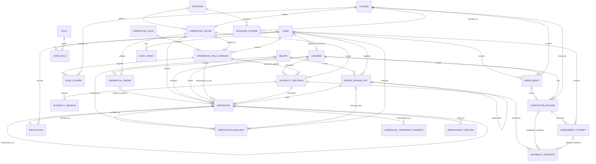

# Logical Relationship Specification — Step 4.1

**Status: MVP DESIGN BASELINE.** The relationships describe the implemented schema and its intended transaction-level invariants. Product assumptions remain separately identified in [DECISIONS.md](../DECISIONS.md); the original requirements remain the source of truth.

## 1. Relationship conventions

- Cardinality is stated as parent → child; “0..1” means optional, “1..N” means one or more, and “0..N” means zero or more.
- Proposed FK deletion behavior is `ON DELETE RESTRICT` throughout. Prefer archival/deactivation. Never cascade-delete audit, credential, verification, key-history, eligibility, or revocation records.
- Bridge rows are relational and have composite uniqueness/primary keys unless an audit/history requirement needs a separate surrogate key.
- Where a relationship spans several columns (for example ensuring a credential and its eligibility decision identify the same learner/rule/scope), use composite FKs where practical; otherwise validate atomically in the application and test concurrency.
- No polymorphic cascade is proposed. `AuditEvent.target_type` + `target_reference` is a durable descriptive reference, not a database FK.

## 2. ER diagram

The diagram includes all nine mandatory entities, proposed supporting entities, and conditional program/timestamp-evidence entities. `||` means exactly one, `o|` zero or one, `|{` one or more, and `o{` zero or more.

`PROGRAM`, `PROGRAM_COURSE`, and `CREDENTIAL_TIMESTAMP_EVIDENCE` are deferred from the MVP. The implemented schema uses one course scope per course and `CREDENTIAL_AWARD` as the unique learner/scope entitlement; original and replacement credential artifacts share the award. User/Role entities are implemented for future actor attribution, but exact permissions remain deny-by-default. The diagram also shows the deferred entities for completeness.

## 3. Relationship inventory

| Parent → Child | Cardinality | FK / nullability | Deletion behavior | Business justification / constraint |
|---|---|---|---|---|
| User → Learner | User 1 → Learner 0..1; Learner 0..1 → User | `Learner.user_id` nullable, unique FK | Restrict | Separate account and learner lifecycle; account linkage is pending. |
| User → UserRole | User 1 → grants 0..N | `UserRole.user_id` mandatory | Restrict | Historical role grants/revocations; partial unique index for one active grant per user/role. |
| Role → UserRole | Role 1 → grants 0..N | `UserRole.role_id` mandatory | Restrict | Normalized many-to-many role assignment; does not encode approved action permissions. |
| Learner → Enrollment | Learner 1 → Enrollment 0..N | `Enrollment.learner_id` mandatory | Restrict | Learner participation history. |
| Course → Enrollment | Course 1 → Enrollment 0..N | `Enrollment.course_id` mandatory | Restrict | Course participation; retake/term uniqueness remains pending. |
| User → Enrollment | User 1 → Enrollment 0..N; Enrollment 0..1 recorder | `Enrollment.recorded_by_user_id` nullable | Restrict | Records actor provenance when accounts exist. |
| Enrollment → CompletionRecord | Enrollment 1 → CompletionRecord 0..1 (proposed) | `CompletionRecord.enrollment_id` nullable pending enrollment policy; unique if present | Restrict | A completion belongs to a participation context. Whether all completion records require enrollment is pending. |
| Learner → CompletionRecord | Learner 1 → CompletionRecord 0..N | `CompletionRecord.learner_id` mandatory | Restrict | Learner's course progress records and history. |
| Course → CompletionRecord | Course 1 → CompletionRecord 0..N | `CompletionRecord.course_id` mandatory | Restrict | Course-level completion is distinct from assessment sittings. |
| CompletionRecord → AssessmentAttempt | CompletionRecord 1 → attempts 0..N | `AssessmentAttempt.completion_record_id` mandatory | Restrict | Preserves every attempt; unique per completion/assessment/attempt number. |
| User → AssessmentAttempt | User 1 → attempts 0..N; attempt 0..1 recorder | `recorded_by_user_id` nullable | Restrict | Grading/recording attribution. |
| AssessmentAttempt → AssessmentAttempt | Prior attempt 1 → superseding attempts 0..N | `supersedes_attempt_id` nullable self-FK | Restrict | Correction/void lineage; never overwrite earlier attempts. Enforce same completion context. |
| CredentialRule → CredentialRuleVersion | Rule 1 → versions 1..N | `CredentialRuleVersion.rule_id` mandatory | Restrict | Version history; unique `(rule_id, version_number)`. Require at least one version before activation at application level. |
| CredentialScope → CredentialRuleVersion | Scope 1 → versions 0..N | `credential_scope_id` mandatory | Restrict | Stable award target independent of rule version. |
| CredentialRuleVersion ↔ Course | M:N via RuleCourse | Both bridge FKs mandatory; composite PK `(rule_version_id, course_id)` | Restrict | A rule version may cover one or many courses; exact scope remains pending. |
| Program ↔ Course | M:N via ProgramCourse (conditional) | Both bridge FKs mandatory; composite PK `(program_id, course_id)` | Restrict | Program composition only if program credentials are approved. |
| Course → CredentialScope | Course 1 → scope 0..1 | `CredentialScope.course_id` mandatory and unique in MVP | Restrict | Exactly one stable course award scope; cardinality matches the unique target constraint. |
| Learner → CredentialAward | Learner 1 → awards 0..N | `CredentialAward.learner_id` mandatory | Restrict | Stable award slots are unique by learner and scope, independent of evaluations or rules. |
| CredentialScope → CredentialAward | Scope 1 → awards 0..N | `CredentialAward.credential_scope_id` mandatory | Restrict | Multiple learners may hold awards for one course scope. |
| CredentialAward → Credential | Award 1 → artifacts 1..N after initial issuance | `Credential.award_id` mandatory; composite FK also enforces learner/scope agreement | Restrict | One root artifact per award; replacements share the slot, require a revoked predecessor, and each predecessor has at most one successor. |
| Program → CredentialScope | Program 1 → scopes 0..N (conditional) | `CredentialScope.program_id` conditional | Restrict | Program-level stable scope identity if approved. `CredentialScope` CHECK requires exactly one target. |
| Learner → EligibilityDecision | Learner 1 → decisions 0..N | `EligibilityDecision.learner_id` mandatory | Restrict | Keeps each evaluation snapshot and outcome. |
| CredentialRuleVersion → EligibilityDecision | Rule version 1 → decisions 0..N | `EligibilityDecision.rule_version_id` mandatory | Restrict | Ties decision to exact rule version. |
| EligibilityDecision → EligibilityReason | Decision 1 → reasons 0..N | `EligibilityReason.eligibility_decision_id` mandatory | Restrict | Normalized reason codes/explanations. |
| EligibilityDecision → EligibilityEvidence | Decision 1 → evidence links 0..N | `EligibilityEvidence.eligibility_decision_id` mandatory | Restrict | Records evidence considered/selected without JSON arrays. |
| CompletionRecord → EligibilityEvidence | Completion 1 → evidence links 0..N | Nullable FK; exactly one evidence-source FK must be non-null | Restrict | Evidence may point to a completion record. |
| AssessmentAttempt → EligibilityEvidence | Attempt 1 → evidence links 0..N | Nullable FK; exactly one evidence-source FK must be non-null | Restrict | Evidence may point to an individual attempt. |
| EligibilityDecision → Credential | Decision 1 → Credential 0..1 | `Credential.eligibility_decision_id` mandatory and unique | Restrict | A decision authorizes at most one artifact; replacements require a fresh eligible decision. Overall award uniqueness is enforced independently by CredentialAward. |
| Learner → Credential | Learner 1 → credentials 0..N | `Credential.learner_id` mandatory | Restrict | Recipient reference; all artifacts for one learner/scope share a unique CredentialAward. |
| CredentialScope → Credential | Scope 1 → credentials 0..N | `Credential.credential_scope_id` mandatory; consistent with award FK | Restrict | Retrieves all artifacts for the stable business scope; uniqueness is enforced by CredentialAward. |
| CredentialRuleVersion → Credential | Rule version 1 → credentials 0..N | `Credential.rule_version_id` mandatory | Restrict | Historical rule attribution for issued artifacts. |
| Issuer → Credential | Issuer 1 → credentials 0..N | `Credential.issuer_id` mandatory | Restrict | Historical issuer identity is fixed in the artifact and issuance-time payload snapshot. |
| Issuer → IssuerSigningKey | Issuer 1 → key records 0..N | `IssuerSigningKey.issuer_id` mandatory | Restrict | Key trust registry; `(issuer_id, key_id)` unique. |
| IssuerSigningKey → Credential | Key 1 → credentials 0..N; each Credential has exactly one key | `Credential.signing_key_id` mandatory; composite issuer/key ownership FK | Restrict | MVP requires an Ed25519 signature and historical key reference. |
| IssuerSigningKey → IssuerSigningKey | Prior key 1 → successor keys 0..N | `supersedes_key_id` nullable self-FK | Restrict | Rotation lineage; never overwrite prior public key record. |
| Credential → Revocation | Credential 1 → Revocation 0..1 under terminal one-revocation proposal | `Revocation.credential_id` mandatory, unique under this proposal | Restrict | Effective revocation is preserved separately; correction/reinstatement policy may change cardinality. |
| User → Revocation | User 1 → revocations 0..N; revocation 0..1 user | `recorded_by_user_id` nullable | Restrict | Human revoker attribution; actor snapshot also supports service actions. |
| Credential → VerificationRequest | Credential 1 → requests 0..N; request 0..1 resolved credential | `credential_id_fk` nullable | Restrict | Unknown portable IDs remain recordable; do not require a Credential FK for every request. |
| Issuer → VerificationRequest | Issuer 1 → requests 0..N; request 0..1 resolved issuer | `resolved_issuer_id` nullable | Restrict | Retains the issuer identity used for historical trust/result reconstruction when known. |
| IssuerSigningKey → VerificationRequest | Key 1 → requests 0..N; request 0..1 resolved key | `resolved_signing_key_id` nullable | Restrict | Retains the exact public-key record used for historical verification when resolved. |
| User → VerificationRequest | User 1 → requests 0..N; request 0..1 requester | `requester_user_id` nullable | Restrict | Authenticated verifier attribution where applicable; privacy policy pending. |
| Credential → CredentialTimestampEvidence | Credential 1 → evidence 0..N | `credential_id` mandatory, conditional entity | Restrict | Stores verifiable independent time proof if approved; ordinary database timestamps are insufficient for that claim. |
| Credential → Credential (replacement) | Predecessor 1 → replacements 0..N | Nullable `replacement_of_credential_id` self-FK | Restrict | Preserves predecessor and replacement history. Whether replacement is permitted and uniqueness policy are pending. |
| User → AuditEvent | User 1 → events 0..N; event 0..1 user actor | `actor_user_id` nullable | Restrict | Retains user actor FK; immutable `actor_reference` preserves non-user/service attribution. |
| Credential → IdempotencyRecord | Credential 0..1 → idempotency records 0..N historically; record 0..1 result credential | `credential_id_fk` nullable | Restrict | Retry record references result without creating circular FK or substituting for award uniqueness. |
| User/service principal → IdempotencyRecord | Principal 1 → records 0..N | `principal_key` is a stable string, no mandatory User FK | Restrict/retention policy | Allows service principals; unique principal + operation + key digest. |

## 4. Referential integrity and lifecycle behavior

1. **No deletion cascade:** Domain identities are archived/disabled; lifecycle and audit rows remain. Hard deletion should be blocked by restrictive FKs. Retention/legal deletion exceptions require a separate approved redaction/pseudonymization policy.
2. **Audit target references:** `AuditEvent` uses a target type and stable business reference because one audit table must cover many entity types without unsafe polymorphic FKs. This field is not referential integrity; audit history remains even if a target is archived. For high-assurance use, add typed reference tables only after the threat model is approved.
3. **Credential status:** Derive active/revoked from credential issuance and effective Revocation records. Avoid duplicate mutable status values that can disagree. If a cached state is later added for performance, update it transactionally and provide reconciliation.
4. **Issue invariants:** A Credential must reference an eligible decision for the same learner, rule version, and scope. Composite FKs enforce reference agreement; one transaction with row locks must additionally verify the decision outcome and that completion evidence predates issuance. CredentialAward has a unique learner/scope constraint, so new decisions, rule versions, issuers, and idempotency keys cannot create another award.
5. **Replace/reissue invariants (MVP assumption IA-06/09):** A replacement has a new credential business ID, remains in the same CredentialAward, references its immediate predecessor, and is accepted only after predecessor revocation. A predecessor may have one successor; the award has one root; no reinstatement or second award slot is allowed.
6. **Evidence invariants:** An EligibilityEvidence row must refer to exactly one CompletionRecord or AssessmentAttempt; its learner must match the EligibilityDecision learner, and an attempt must belong to a completion for that learner/course. Use composite keys/transaction validation rather than trusting JSON.
7. **Key invariants:** Signing key issuer must equal Credential issuer; key ID, algorithm, and validity metadata are immutable historical references. Rotation inserts a key record and links it to its predecessor; it does not replace the prior row.
8. **Verification invariants:** `credential_id_fk` is set only when a stored credential is resolved. Portable payload outcomes separate digest/signature/trust from revocation status. Unknown and unavailable states must not become active.
9. **Timestamp invariants:** `recorded_at` and `issued_at` establish system-recorded chronology only. A trusted timestamp proof must be separately linked and validated to support a historical signing-time assertion.

## 5. Pending relationship decisions

- Is credential scope course-only, program-level, or both? MVP assumes course-only; Program/ProgramCourse are deferred.
- Is Enrollment required for every CompletionRecord? Can a learner repeat a course and receive a new completion?
- Are rule versions one-course or multi-course? How does a program rule select required courses?
- Should repeatable award cycles exist beyond one CredentialAward per learner + stable scope? MVP assumes no.
- Is the MVP's linked replacement-after-revocation behavior acceptable, and should reinstatement ever be supported?
- Can a decision authorize multiple scope awards or only one? This model binds one rule version/scope to a decision and proposes one credential per decision.
- What score scales, attempt numbering, corrections, and selection policy apply?
- Which actor/user relationships and permissions are approved?
- Are signature timestamps independently trusted? If so, which source and proof format?
- What revocation effective-time and correction model applies?

All are **PENDING USER APPROVAL**. No phase is marked complete by this logical relationship draft.
