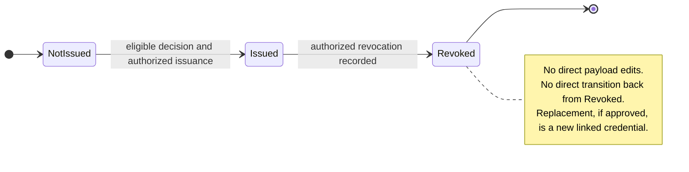
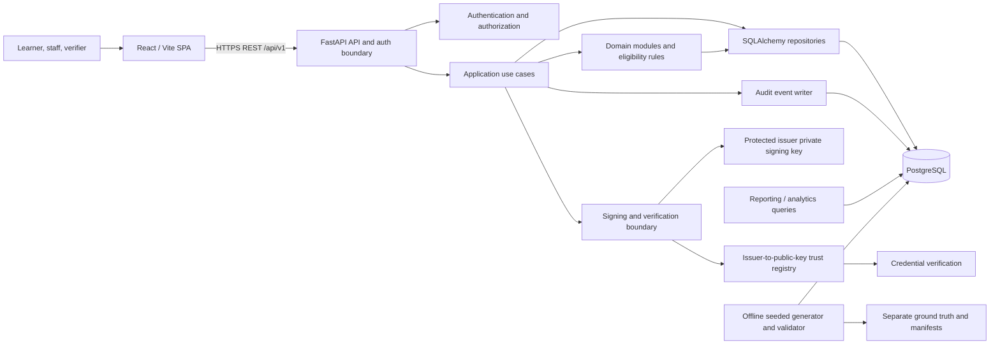

# System Architecture Proposal — Phase 2

**Status: IN REVIEW — proposal only; pending user approval.** This document describes a recommended design, not implemented behavior or approved business decisions. The binding requirements remain [the original problem statement](original-problem-statement.md). Nothing here creates a schema, API, security guarantee, or change to the scaffold.

## 1. Architecture overview

### 1.1 Recommended style

Use a **modular monolith**: one React single-page application, one versioned FastAPI application, and one PostgreSQL database. Keep domain capabilities in explicit backend modules and service boundaries, but deploy and operate one backend unit for the hackathon. Run synthetic-data generation and validation as offline, reproducible commands that use shared domain rules without exposing ground-truth labels to application decisions.

This is a proposal consistent with the user's preference for a modular monolith. It is not approval to add components or begin implementation. Microservices add network, deployment, consistency, and debugging costs without a demonstrated scale or team-boundary need here. Modules can be extracted later if evidence justifies it.

### 1.2 Responsibilities and boundaries

| Layer | Responsibility | Must not own |
|---|---|---|
| React/Vite client | Role-appropriate screens, form-level feedback, API calls, and presentation of business decisions. | Eligibility authority, credential-signing keys, authorization enforcement, ground-truth labels. |
| FastAPI transport/API | Versioned HTTP routes, authentication extraction, request/response validation, authorization dependency invocation, status/error mapping. | Domain policy or direct persistence logic embedded in route handlers. |
| Application services | Orchestrate use cases and transaction boundaries: evaluate, issue, verify, revoke, investigate. | Framework-independent rule definitions or uncoordinated table writes across services. |
| Domain modules | Learner/course/rule/completion/credential lifecycle concepts, invariants, and eligibility decisions. | HTTP concerns, secrets, or ground-truth labels. |
| Repositories / persistence | SQLAlchemy persistence, queries, and transaction participation; PostgreSQL constraints enforce invariants. | Business authorization policy or silent integrity fallbacks. |
| Integrity/security services | Password/JWT helper boundaries, canonical credential payload, signing and verification, key identifiers. | Publicly exposing signing keys or treating a digest alone as issuer authentication. |
| Audit service | Record attributed, timestamped outcomes and lifecycle changes within the use-case transaction where possible. | Mutable “current state only” records that erase history. |
| Reporting service | Read-only aggregates and traceable metrics over operational data. | Ground-truth leakage into application features or eligibility decisions. |
| Data tooling | Seeded synthetic generation, isolated labeled anomaly fixtures, data-quality validation, and reproducibility manifests/reports. | Mutating valid baseline records to create anomalies or feeding labels to the application. |

### 1.3 Internal backend modules and dependencies

Proposed boundaries under the existing `backend/app/` modular scaffold:

- `api/v1/endpoints/` — thin HTTP adapters grouped by capability.
- `core/` — settings, logging, shared API error mapping, and security primitives.
- `database/` — engine, session lifecycle, declarative base, and transaction/session dependencies.
- `models/` and `schemas/` — persistence mappings and transport validation; keep DTOs distinct from domain decisions.
- `repositories/` — persistence interfaces/implementations, constraints-aware lookups, and reporting queries.
- `services/` — use-case orchestration, separated by credential lifecycle capability.
- `rules/` — versioned eligibility evaluation semantics, independent from HTTP and data labels.
- `middleware/` — only cross-cutting HTTP concerns such as request IDs; authorization should remain explicit and testable.
- `utils/` — small shared primitives only; avoid a miscellaneous business-logic module.
- A future `data/` command package or `backend/scripts/` may host offline generator and validator entry points after scope is approved. The current placeholders are empty; this proposal does not establish a file layout.

Dependency direction: HTTP endpoints → application services → domain/rule contracts and repositories → SQLAlchemy/PostgreSQL. Security and audit components are invoked explicitly by use cases. Domain/rule code must not import FastAPI, and repositories must not decide whether a caller is authorized.

### 1.4 Communication and deployment

Browser → HTTPS REST API `/api/v1` → FastAPI service → SQLAlchemy/psycopg → PostgreSQL. Within Docker Compose, backend connects to database by service name. The third-party verifier calls a narrowly scoped public verification interface; it does not receive administrative or learner-management access. Exact public disclosure is pending approval.

Development deployment stays within the existing Compose topology: frontend, backend, and PostgreSQL. Production-grade TLS termination, secrets management, backup/restore, monitoring, and rate-limiting infrastructure are not present in the scaffold and must not be implied by it.

### 1.5 Rationale

- One transaction boundary can coordinate eligibility evidence, credential uniqueness, lifecycle state, and audit events.
- A single deployment is tractable for a hackathon and local Compose workflow.
- Module boundaries retain testability and future extraction options.
- PostgreSQL constraints can be the final enforcement layer for uniqueness and relational integrity.
- Offline deterministic generation and separate ground truth support the explicit evaluation/reproducibility requirements without coupling evaluation labels to production behavior.

### 1.6 Identifier conventions

Preserve the stipulated domain ID formats and prefixes, including learner ID `LRN-000001` and credential ID `CRD-2026-000001`. These formats are not pending a design choice: do not replace them with UUIDs or unprefixed integers as externally visible business identifiers. A separate internal database primary key may be considered, but it does not replace the required/presented domain identifier. Apply the formats consistently in generated data, API contracts, reports, audit references, and fixtures.

The current `docs/original-problem-statement.md` lists entity/key requirements but does not itself spell out these two formats; they are stipulated by the Phase 2 correction request. Only the credential year source/semantics, sequence allocation scope, padding/overflow behavior, and formats for other entities remain **PENDING USER APPROVAL**.

## 2. System components

The following are proposed responsibilities and dependency order, not implemented components.

| # | Component | Responsibilities and interactions | Dependencies |
|---:|---|---|---|
| 1 | Authentication and authorization | Validate credentials/tokens; establish caller identity; enforce role and object-level scope on every protected use case. | User/role management, API dependencies, secret configuration. |
| 2 | User and role management | Maintain or provision accounts, password hashes, role assignments, and account lifecycle; never let ordinary users self-assign privileged roles. | Authentication, audit. Detailed model and provisioning are undecided. |
| 3 | Learner management | Maintain learner profile and stable identifier; apply agreed privacy/access boundaries. | User mapping if learners authenticate; audit; PostgreSQL. |
| 4 | Course management | Maintain course catalog, lifecycle/effective dates, and issuer/program associations as approved. | Rule management, enrollment/completion, audit. |
| 5 | Credential rules management | Maintain validated, versioned eligibility requirements and course scope/effective dates. Existing decisions must remain explainable against the exact rule version used. | Courses, authorization, audit, eligibility engine. |
| 6 | Enrollment and completion management | Record enrollment, completion state, assessment attempts/results, provenance, and effective dates. Prevent orphaned parent references. | Learners, courses, assessment policy, authorization, audit. |
| 7 | Eligibility evaluation engine | Evaluate an immutable snapshot of applicable rule version and relevant completion/assessment evidence; return an explicit decision with reasons and references. No issuance if requirements fail or evidence is invalid/ambiguous. | Rules, completion data, learner/course data; decision persistence; audit. |
| 8 | Credential issuance service | Re-check authorization and passing eligibility, enforce unique IDs/idempotency and transaction safety, construct canonical payload, request signature, persist issuance and audit atomically. | Eligibility decision, issuer, integrity service, credential repository, audit. |
| 9 | Cryptographic signing and verification service | Canonicalize signed fields, compute SHA-256 digest, sign using protected issuer key, verify signature and digest using a trusted public-key/key-ID mapping. | Key custody/configuration, issuer identity, credential payload contract. The signature algorithm and trust distribution require approval. |
| 10 | Third-party verification service | Validate input, retrieve credential and current revocation status, verify payload/signature, apply disclosure policy, record a verification request and outcome. | Credential, revocation, cryptographic service, privacy decision, audit/rate controls. |
| 11 | Credential revocation service | Authorize and validate revocation, preserve reason/effective time, transition credential once, and persist the revocation and audit record transactionally. | Credential, issuer/actor authorization, lifecycle policy, audit, verification. |
| 12 | Audit logging service | Capture actor/service, action, target, request/correlation ID, timestamp, outcome, and minimal reason/reference. Preserve event history and protect it from ordinary update/delete. | All write use cases, transaction coordination, trusted clock/logging. |
| 13 | Reporting and analytics | Provide access-controlled counts and outcome metrics (eligibility, issuance, verification, revocation, errors, anomaly checks) with definitions and time windows. | Operational tables/events, privacy controls, audit of sensitive exports. |
| 14 | Synthetic data generation and validation | Produce deterministic baseline at required volumes, then isolated labeled edge cases; check joins, lifecycle/date/enumeration rules, checksums and repeatability. | Agreed schema/rules, fixed seed `20261022`, isolated test/evaluation environment, separate ground truth. |
| 15 | Issuer and signing-key trust management | Maintain issuer identity/status and an auditable registry of issuer-bound public keys and historical key metadata; approve/bootstrap trust, rotate keys, and retain old public keys for historical verification. | Issuer authorization, signing service, verification service, audit, protected key custody. |

Suggested write dependency graph:

```text
Users/Roles ──> Authorization ──> every protected use case
Learners + Courses ──> Enrollment/Completion ──> Eligibility Rules/Evaluation
Eligibility(pass) + Issuer ──> Signing ──> Credential Issuance
Credential + Signature + Revocation State ──> Third-Party Verification
Every state-changing use case ──> Audit Event
Operational records/events ──> Reporting
Domain rules/schema ──> Offline generation ──> validation + separate ground truth
Issuer identity ──> Key trust registry ──> Signing and both verification modes
```

### 2.1 Mandatory entities and proposed supporting records

The original mandatory entities remain in scope. This table assigns proposed architectural ownership only; attributes, cardinalities, lifecycle values, and relationships remain for later schema design and user review.

| Entity | Proposed responsibility / owning capability |
|---|---|
| Learner | Learner management; stable externally visible ID such as `LRN-000001`. |
| Course | Course management and course lifecycle. |
| CredentialRule | Versioned eligibility scope and policy. |
| CompletionRecord | Learner/course-level completion status and provenance; not an assessment sitting. |
| Credential | Issued signed record and lifecycle reference; externally visible ID such as `CRD-2026-000001`. |
| Issuer | Issuer management; stable issuer identity and historical credential attribution. |
| VerificationRequest | Verification service; distinguishes credential-ID lookup from portable-payload verification and persists outcome metadata. |
| Revocation | Revocation service; authorized action, reason reference, effective time, and lifecycle history. |
| AuditEvent | Audit service; attributed state changes, decisions, verification outcomes, and relevant failures/access. |
| Enrollment (supporting, if justified) | Learner/course participation and effective lifecycle, if it is needed beyond CompletionRecord. |
| RuleCourse (supporting, if justified) | Explicit many-to-many course scope for a CredentialRule. |
| EligibilityDecision (supporting) | Explainable evaluation snapshot linked to exact rule, completion and assessment evidence. |
| AssessmentAttempt (proposed supporting record) | One append-only individual assessment sitting/result; preserves history separately from CompletionRecord. |
| User/Role and issuer-key registry records (supporting, subject to approval) | Identity/authorization and trusted issuer key lifecycle; requirements and records need approved schema. |

### 2.2 Completion records and assessment attempts

`CompletionRecord` and an assessment attempt are different concepts. Proposed `CompletionRecord` represents a learner's course-level participation/completion outcome and its provenance (for example, in progress or completed); it is not one exam sitting and must not overwrite assessment history. Each submitted assessment sitting is a separate, append-only `AssessmentAttempt` supporting entity, linked to the learner, course, and assessment/rule scope. An attempt records its stable attempt identifier/number, submitted/graded timestamps, score or outcome, source, and any correction/void/supersession reference. Corrections create an attributable superseding/void event; they do not erase the original attempt.

A versioned rule may specify an attempt-selection policy and its scope (assessment, course, rule version, accepted time window, allowed attempt count, passing threshold). Proposed policy semantics:

- **`latest`:** use the most recent valid, non-voided attempt by attempt timestamp; resolve ties with a stable attempt sequence/ID.
- **`highest`:** use the highest valid score on a comparable, rule-defined scale; scores from unlike scales must not be compared without an approved normalization. Resolve ties by the latest attempt timestamp and then stable attempt sequence/ID.
- **`any_pass`:** pass when at least one valid, non-voided in-scope attempt meets the rule threshold.
- **Fixed/other policy:** only if explicitly represented and documented in the applicable rule version.

The evaluator records the policy, selected attempt IDs (or all considered attempt IDs for `any_pass`), and result in the EligibilityDecision snapshot. No attempt, invalid/superseded evidence, ties without a deterministic rule, or attempts outside the rule's scope must not silently become a pass; behavior is an explicit fail or needs-review outcome under the approved rule. Selection policy, tie-breaking, correction handling, and missing-attempt behavior are **PENDING USER APPROVAL**.

## 3. Core workflows

All records and transaction details below are recommendations. Exact actor permissions, business thresholds, statuses, and disclosure are pending user approval. Audit event names are illustrative.

### 3.1 Learner enrollment and course completion

- **Actor:** Learner requests enrollment; an authorized Instructor or Academic Administrator records/approves enrollment and completion. Exact allocation is unresolved.
- **Trigger:** Enrollment submission/approval or an authorized completion/assessment submission.
- **Preconditions:** Learner and Course exist and are eligible for the operation; caller is authorized for the target; effective dates and assessment policy are satisfied.
- **Processing:** Authenticate and authorize; validate IDs, enum values, dates and score bounds; persist enrollment, a course-level CompletionRecord, or an individual AssessmentAttempt as the correct distinct record, with source actor and timestamp; enforce parent FKs and agreed uniqueness; append a corresponding event in the same transaction. Grading a later attempt does not erase an earlier attempt or itself overwrite the course-level completion record.
- **Database interactions:** Read Learner/Course; insert/update Enrollment or CompletionRecord as appropriate; insert a separate AssessmentAttempt for every sitting and AuditEvent; commit atomically.
- **Success:** Return the created/updated record and current state (201 for created, 200 for update).
- **Failures:** 401 unauthenticated; 403 wrong role/scope; 404 parent missing; 409 duplicate/conflicting lifecycle state; 422 malformed or out-of-range data; 500/503 on unexpected persistence failure, without success-shaped fallback.
- **Audit:** `EnrollmentCreated/Changed`, `CompletionRecorded/Changed`; denied or invalid attempts may produce restricted security/application events with minimal input data.

### 3.2 Eligibility evaluation

- **Actor:** Authorized Instructor/Academic Administrator, or the approved automated workflow; exact trigger is unresolved.
- **Trigger:** Explicit evaluation request, relevant completion update, or approved scheduled action.
- **Preconditions:** Learner, applicable rule version, required course scope, and evidence exist; the rule is effective at the defined evaluation time.
- **Processing:** Resolve and pin rule version and evidence snapshot; evaluate every condition against the course-level CompletionRecord and individually preserved AssessmentAttempts using the rule's configured attempt-selection policy; record pass/fail/needs-review plus policy, selected/considered attempt references, reason codes and evidence references; do not mutate source completion or attempt history; do not use ground-truth labels.
- **Database interactions:** Read learner, course, rule/version, CompletionRecord and AssessmentAttempt history; insert EligibilityDecision snapshot and AuditEvent; apply transaction/isolation rules sufficient to avoid mixing incompatible snapshots.
- **Success:** Return decision ID, outcome, rule version, evaluated-at time, and explainable reason summary (200 or 201 depending on create/re-evaluation semantics, to be finalized).
- **Failures:** 401/403; 404 unknown target; 409 stale/conflicting rule or evidence; 422 invalid evaluation request; 503 evaluation dependency failure. Ambiguous/missing evidence must not default to eligible.
- **Audit:** `EligibilityEvaluated` with input version references, outcome, and correlation ID; record failure/exception with a safe reason code.

### 3.3 Credential issuance

- **Actor:** Issuance authority is unresolved: possible Academic Administrator, dual approval, or controlled automation.
- **Trigger:** Explicit issuance request for an eligible decision, or an approved automatic issue event.
- **Preconditions:** Authenticated authorized actor/process; current decision is passing and refers to the applicable rule/evidence; issuer is active; credential is not already issued; signing key is available and correct for issuer/key version.
- **Processing:** Begin transaction; lock/check eligibility and issuance idempotency; enforce the approved learner-plus-credential-scope business uniqueness independently of eligibility-decision, rule-version, issuer, or idempotency-key identifiers; allocate the next identifier in the preserved `CRD-2026-000001` format; create canonical immutable payload with issuer, subject reference, credential/rule version and recorded issue time; compute SHA-256 and sign; insert Credential and AuditEvent; commit as one unit. If signature creation fails, do not persist a valid-looking credential. The numeric suffix must be allocated atomically, never by an unprotected `MAX(id) + 1`.
- **Database interactions:** Read/lock eligibility decision and issuer; obtain an atomic identifier from an issuer/year or global counter (scope pending); insert Credential with a global unique constraint on its credential ID and a unique business issuance identity/idempotency reference; append AuditEvent in the same transaction. Database uniqueness constraints are the final defense against concurrent duplicate attempts.
- **Success:** 201 with credential ID and authorized response; do not return private key material.
- **Failures:** 401/403; 404 unknown decision/issuer; 409 already-issued, non-passing/stale decision, or uniqueness race; 422 invalid request; 503 signing/key or database unavailable. Roll back credential/audit state together.
- **Audit:** `CredentialIssued` records actor, issuer, credential ID, eligibility/rule references, payload digest/key ID, and recorded issuance time; record independently trusted timestamp evidence separately if used. Do not imply the ordinary database timestamp independently proves signing time. Never record private keys or unnecessary learner data.

### 3.4 Credential verification by a third party

- **Actor:** Third-party Verifier; anonymous access versus authenticated verifier is pending decision.
- **Trigger:** Submit either a registry credential ID or a portable signed payload. These are distinct verification modes with distinct evidence and response guarantees.
- **Preconditions:** Request is well-formed and within agreed rate/access limits; disclosure policy permits the requested fields.
- **Processing:** Follow exactly one mode below; validate integrity/issuer trust and current revocation independently; determine overall result without exposing private learner data by default; persist request/result.
- **Database interactions:** Mode-specific lookup described below; insert VerificationRequest and AuditEvent. Avoid stale cached revocation status unless an explicit freshness SLA is adopted.
- **Success:** 200 with an explicit mode, authenticity/integrity/trust result, lifecycle status (known, unknown, or unavailable), and only approved disclosure. Do not claim ID possession from ID lookup alone.
- **Failures:** 400/422 malformed; 404 may be used for unknown IDs, subject to privacy/timing policy; 429 rate limited; 503 authoritative key/revocation status unavailable. Do not return an overall valid/active result when a required check cannot be completed.
- **Audit:** `VerificationRequested` and `VerificationCompleted` with mode, outcome, timestamp, request ID, key ID when known, and minimal requester metadata subject to privacy/retention policy.

#### 3.4.1 Credential-ID verification

- **Input:** A credential identifier in the preserved `CRD-2026-000001`-style format; it is a registry lookup, not a holder-presented payload.
- **Processing:** Validate ID syntax; find the stored credential; load its immutable signed payload, issuer identity, signing key ID, recorded issuance/audit time, and any separate independently trusted timestamp evidence; recompute the canonical SHA-256 digest; resolve the issuer-bound public key; verify signature/trust and key validity at the supported signing time; read current authoritative revocation state. Do not treat the ordinary database issuance or audit timestamp as independently trusted signing-time evidence.
- **Evidence and limits:** This proves the stored registry record's integrity/authenticity and lifecycle status to the extent that the issuer trust and timestamp evidence permit. It does **not** prove that the caller possesses the credential, that a person presenting the ID is its subject, or that a user-supplied copy matches the stored record.
- **Response:** Return mode `credential_id`, whether the ID was found, authenticity/integrity/trust outcome, current lifecycle status, verification time, and only approved issuer/course/subject disclosure. If the ID is unknown, return an explicit unknown/not-found outcome under the approved anti-enumeration policy.
- **Failure handling:** Key-registry outage or unavailable authoritative revocation state yields an indeterminate/unavailable response (normally 503); unknown key or invalid signature yields a non-valid result; none are active/valid.
- **Database interactions/audit:** Read the canonical stored credential, issuer/key references, and revocation; persist the verification request and outcome. Never mutate the credential on verification.

#### 3.4.2 Portable signed-payload verification

- **Input:** A self-contained signed credential payload, containing at minimum a credential ID, issuer identity, key ID, payload/canonicalization version, signed claims, digest, and signature according to the eventual contract. Any independently trusted timestamp proof may be carried alongside the payload or resolved through an approved trusted source; the payload's own `issued_at` claim is not such proof.
- **Processing:** Enforce size/schema limits; canonicalize the submitted signed fields; recompute SHA-256; resolve the key by the payload's issuer plus key ID in the trust registry; verify signature, key/issuer binding and supported signing-time validity using separately identified evidence; if the payload contains a recognized credential ID, query authoritative current revocation status. Never treat an ordinary database timestamp or submitted status/digest as independent proof.
- **Evidence and limits:** A valid signature can establish that a trusted issuer key signed the canonical payload. It does not by itself establish that the credential remains unrevoked. For an otherwise valid portable payload whose revocation state cannot be authoritatively checked, report authenticity separately and lifecycle as unknown/unavailable; overall verification is not “currently valid.”
- **Response:** Return mode `signed_payload`, payload-integrity result, issuer-trust/signature result, credential ID if safe, revocation/lifecycle status (`active`, `revoked`, `unknown`, or `unavailable`), verification time, and minimal approved claims. Distinguish invalid from unverifiable; do not silently accept unsupported versions or keys.
- **Failure handling:** Malformed/oversized payload returns 400/413/422; unknown or untrusted issuer/key returns a non-valid trust result (or a policy-approved generic response); temporary registry outage returns 503; revocation-store outage returns 503 or an explicit indeterminate outcome, never active. Do not persist the full submitted payload unless retention/privacy policy explicitly allows it.
- **Database interactions/audit:** Resolve trusted key and any known credential/revocation; persist a minimal request digest, mode and outcome in VerificationRequest/AuditEvent, not an unrestricted raw payload.

#### 3.4.3 Key and revocation availability/validity outcomes

The verifier must report signature authenticity/trust separately from current lifecycle status. “Signature authentic” is not equivalent to “currently active.” Apply these proposed outcomes consistently in both verification modes:

| Condition | Authenticity / key result | Lifecycle status | Overall result and HTTP behavior |
|---|---|---|---|
| Key ID is unknown or not trusted for the stated issuer | `untrusted_key` / `unknown_key` | Check revocation only if an authoritative credential record can independently be identified; otherwise `unknown` | Processed non-valid verification outcome (normally 200); never trust a public key supplied only in the payload. |
| Trusted key registry is temporarily unavailable | `unverifiable` / `trust_status_unavailable` | Independently known revocation may be shown only if safely available; otherwise `unavailable` | 503 or explicit indeterminate outcome per final API contract; never `valid_active`. |
| Key is expired now but was valid at a trustworthy issuance/signing time | Signature may be `valid_historical` | Query current revocation status independently | Historical authenticity can pass; current status is active/revoked/unknown as determined. Present-day expiry alone does not invalidate historical signatures. |
| Key was not yet valid or had expired at the trusted signing time | `invalid_key_validity` | Independent known status may be reported, but cannot make the credential authentic | Non-valid result; no active/valid overall outcome. |
| Key is retired after the credential was issued | Verify historical signature using retained public key and trusted historical timestamp evidence | Query current revocation status | Historical verification is permitted if issuer trust and signing-time validity are established; retired key cannot sign new credentials. |
| Key is revoked/compromised | Apply approved compromise cutoff policy; if reliable evidence proves issuance predates compromise, historical result may be separately reported | Query current status independently | If time/order cannot be established, report `indeterminate`/non-valid rather than assuming historical validity. Never use compromised key for new issuance. |
| Revocation store/database is unavailable or stale beyond an approved freshness bound | Signature/integrity may still be independently reported | `status_unavailable` | Overall current validity is indeterminate; return 503 or explicit unavailable result. Never report active based on stale/failed lookup. |
| Credential is authoritatively found revoked and effective | Signature may still be authentic | `revoked` | `valid_revoked`/not active. A valid signature never overrides revocation. |

For a portable payload with no registry record, issuer signature can be verified if the public key is trusted, but current revocation cannot be asserted unless the verifier has an authoritative revocation/status source. Return authenticity and lifecycle separately and do not call it currently active. Any historical verification requires trusted timestamp evidence; the signed payload's own `issued_at` claim alone is insufficient.

### 3.5 Credential revocation

- **Actor:** Authorized Academic Administrator or Platform Administrator, subject to approved scope; exact authority and dual-control need clarification.
- **Trigger:** Revocation request with reason and effective time.
- **Preconditions:** Credential exists and is issued; actor may revoke this credential; reason is supplied if required; request is not a forbidden lifecycle transition.
- **Processing:** Authenticate/authorize; lock credential; validate current state; record a Revocation with actor, reason code, effective time; transition credential to revoked; append audit event in one transaction. Repeating an identical request returns conflict or idempotent existing result according to approved policy.
- **Database interactions:** Read/lock Credential; insert Revocation; update current status or derive it from revocation record; append AuditEvent; commit atomically.
- **Success:** 200 or 201 with revoked state, effective time and revocation ID.
- **Failures:** 401/403; 404 unknown credential; 409 already revoked or forbidden transition; 422 missing/invalid reason/date; 503 on persistence failure. No partial status transition.
- **Audit:** `CredentialRevoked` captures prior/new state, actor, reason reference, effective time and correlation ID.

### 3.6 Verification of a revoked credential

- **Actor:** Third-party Verifier.
- **Trigger:** Verify an ID/payload after revocation.
- **Preconditions:** Same request checks as normal verification; a revocation record is effective under the approved time semantics.
- **Processing:** Apply the relevant credential-ID or portable-payload mode; validate signature independently; consult authoritative current revocation state after integrity validation; effective revocation takes precedence over active status even when signature is authentic. Preserve the fact that signature authenticity and active status are separate dimensions.
- **Database interactions:** Read credential or submitted signed payload, issuer/key metadata and authoritative revocation; insert VerificationRequest and AuditEvent.
- **Success:** 200 with mode, `authenticity` and `lifecycle_status` reported separately, e.g. authentic record / revoked, not active. Exact public fields are pending.
- **Failures:** Unknown/stale status or database error must not be mapped to active/valid; return the agreed unavailable outcome/status.
- **Audit:** `VerificationCompleted` with revoked result and revocation reference; no sensitive reason disclosure unless approved.

### 3.7 Invalid or tampered credential verification

- **Actor:** Third-party Verifier; an administrator may later investigate.
- **Trigger:** A presented credential has an unknown ID, malformed payload, altered signed fields, digest mismatch, invalid signature, or untrusted key.
- **Preconditions:** Request can be safely parsed/rate-limited.
- **Processing:** Canonicalize exactly the signed fields; recompute SHA-256; verify signature under issuer/key trust policy; reject mismatches. Do not overwrite stored credentials based on submitted content. Keep `not found`, `invalid`, and `temporarily unverifiable` distinguishable internally.
- **Database interactions:** Read credential/key metadata as needed; insert failed VerificationRequest/outcome and restricted AuditEvent; do not update credential lifecycle state.
- **Success:** A processed verification returns an explicit non-valid result (usually 200 as a verification outcome); malformed transport/request may return 400/422.
- **Failures:** Fail closed on missing key, algorithm mismatch, canonicalization failure or unavailable status; do not silently accept or fall back to hash-only authenticity.
- **Audit:** `VerificationCompleted` with a safe reason code (digest mismatch, signature invalid, unknown key, not found); avoid storing raw sensitive payloads.

### 3.8 Duplicate credential issuance prevention

- **Actor:** Authorized issuer or approved automated process; races may involve concurrent callers.
- **Trigger:** Repeated request, retry after timeout, or concurrent issue requests for the same learner and credential scope, including requests based on different eligibility-decision snapshots.
- **Preconditions:** Valid passing decision and authorized caller.
- **Proposed uniqueness scopes:** (1) credential ID is globally unique across issuers and years, enforced by a database unique constraint; (2) normal business issuance is unique for the approved learner and credential scope (and any explicitly approved award-cycle dimension). This identity must not include eligibility-decision ID, rule-version ID, issuer ID, or idempotency key as a means of creating another normal award: a new evaluation or rule snapshot for the same learner/scope cannot bypass uniqueness. Exact scope and any repeatable award-cycle semantics remain pending approval.
- **Legitimate replacement/reissue:** A replacement or reissue is a separately authorized exception, not a second normal issuance. It must follow an explicitly approved policy, carry a distinct credential ID, reference its predecessor and reason, and preserve the original credential and lifecycle/audit history. It must not be enabled merely by submitting a new decision ID, changing rule version, issuer, or idempotency key.
- **Proposed idempotency:** Require an idempotency key on issuance. Scope its stored record to authenticated principal + operation + key and persist a canonical request fingerprint and original result. A retry with the same scope/key and same request returns the original credential/result without another credential or `CredentialIssued` event. Reuse of that key with a different request returns 409. Concurrent identical requests converge on one committed result; a transaction race losing the unique constraint must reload/return the matching idempotent result or return 409, never create a second credential.
- **Identifier allocation:** Allocate the next `CRD-2026-000001`-style number atomically from a database sequence/counter under the approved global or issuer/year scope. Sequence gaps after rollback are acceptable; reuse is not. Do not derive the next value with an unlocked maximum query.
- **Database interactions:** Read/lock eligibility and issuer; atomically allocate the identifier; insert Credential with credential-ID uniqueness and a business-issuance uniqueness constraint independent of decision snapshots, plus idempotency result; append AuditEvent in the same transaction; handle known uniqueness conflicts deterministically. Any replacement exception must be represented explicitly and constrained by the approved replacement policy.
- **Success:** Exactly one normal credential for the approved learner/scope business identity. Same-key/same-request retry returns the original outcome; exact response replay and retention duration require approval. An approved replacement is separately linked and auditable, not another normal issuance.
- **Failures:** 409 for key reuse with a different request, an already-issued business identity, or a genuine conflicting duplicate; 503 for transaction failure. Roll back all partial records. A retry after an ambiguous connection failure must query idempotency state before attempting a new issue.
- **Audit:** One successful `CredentialIssued`; rejected/conflicting `CredentialIssuanceRejected` event if safe and useful. Do not log duplicate private payloads.

### 3.9 Administrative investigation and audit

- **Actor:** Authorized Academic Administrator, Support Staff, or Platform Administrator according to approved role scope.
- **Trigger:** Investigation of a decision, verification exception, anomaly, issuer/rule change, or lifecycle event.
- **Preconditions:** Caller authenticated and authorized for target/fields; a credential or correlation ID is available.
- **Processing:** Query historical audit/decision/rule/issuer versions; reconstruct event chronology and distinguish original records from later corrections/replacements; record sensitive audit access/export; do not edit prior events.
- **Database interactions:** Read scoped audit and business history; insert audit-access event; paginate and filter safely.
- **Success:** Chronological, provenance-aware timeline with stable references and authorized redaction.
- **Failures:** 401/403; 404 unknown target; 422 invalid filters; 429 or bounded-query rejection; 503 data store unavailable.
- **Audit:** `AuditHistoryViewed/Exported` and any investigation conclusion as a separate event; preserve source events.

## 4. Credential lifecycle and state model

These are separate dimensions. A verification result is a per-request observation, not a mutable credential state.

### 4.1 Eligibility decision — proposed states

`not_evaluated` (absence of a decision) → `eligible` or `ineligible`; `needs_review` may represent unresolved/invalid evidence rather than a pass. A new evaluation creates a new decision snapshot referencing exact rule and evidence versions; it does not rewrite a previously relied-upon decision. Whether a passing decision expires, is superseded, or can support multiple credentials is pending.

Only a current `eligible` decision may authorize issuance. `ineligible`, `needs_review`, missing, stale, or invalid evidence must not issue. Do not equate rule evaluation with credential status.

### 4.2 Credential issuance/lifecycle state — proposed states

- **Not issued:** no credential exists; this is absence, not necessarily a credential row/state.
- **Issued:** immutable issued artifact and issuer signature are present.
- **Revoked:** revocation event exists and the credential is not active. Treat as terminal by default in this proposal.

Permitted: no credential → issued after all requirements pass; issued → revoked through authorized, recorded action. Forbidden: issue without eligible evidence; edit signed payload in place; issue same issuance identity twice; revoked → issued/active by direct state update.

If a credential must be corrected or restored, the recommended model is a new, linked replacement credential with its own eligibility/issuance record and complete audit trail; never erase the original revocation. Whether replacement or reinstatement is permitted requires approval.

### 4.3 Verification result — proposed per-request outcomes

Possible independent outcomes: `valid_active`, `valid_revoked`, `invalid_digest`, `invalid_signature`, `unknown_credential`, `untrusted_key`, `malformed`, and `status_unavailable`. This list and disclosure mapping are proposals. A valid signature means the signed bytes match a trusted issuer key; it does not establish current non-revocation. `status_unavailable` must never be treated as active.

### 4.4 Revocation state — proposed

The absence of a Revocation record means no revocation is recorded. A revocation request may be `pending` only if a future effective date or approval workflow is explicitly adopted; otherwise the approved revocation is effective immediately. A future-dated revocation becomes `effective` at its agreed effective time. There is no `reinstated` or silently deleted state in this proposal. Corrections, if allowed, require a new, attributed event and user-approved semantics. A credential is not active once its revocation is effective. Exact effective-time, time-zone, and future-dating rules remain unresolved.

### 4.5 State diagram



## 5. Security architecture

Security controls below are proposals. They require threat-model and user review before implementation.

### 5.1 Passwords, authentication, and JWT

- Store only salted, adaptive password hashes; **Argon2id** is a recommended password-hashing choice if compatible with the selected library/runtime. Never encrypt passwords for later recovery or log credentials.
- Use TLS for credentials/tokens outside local development.
- JWTs should be short-lived and signed with an explicitly configured algorithm; validate signature, issuer, audience, expiry, not-before, subject, and token identifier. Do not trust an algorithm supplied by the token. Secret/key rotation and revocation strategy remain unresolved.
- For a browser app, prefer a `Secure`, `HttpOnly`, appropriately `SameSite` cookie if deployment origins permit; if bearer tokens are used, do not store long-lived tokens in `localStorage`. Cookie-based auth requires CSRF protection. Final browser token strategy is pending.
- JWT claims should identify the principal and minimal roles/scopes, not embed unnecessary PII. Re-check account/role state for sensitive actions where stale access is unacceptable.

### 5.2 Authorization

- Enforce authorization on the backend, at the use-case boundary; frontend route guards are UX only.
- Use role-based permissions plus object-level scope checks (for example instructor/course assignment or admin jurisdiction) once defined. Deny by default; prevent privilege escalation and learner/verifier access to management endpoints.
- Separate public verification capability from authenticated administrative APIs; apply a minimal response schema and rate controls.
- The actor-to-action matrix below is unresolved and must be approved before role-dependent behavior is implemented. No role is granted by this proposal.

#### Actor-to-action authorization matrix (all entries pending)

`Pending approval` means the actor's permission is intentionally unspecified. It is not a grant or denial. Authentication/authorization must default to deny until the user approves the matrix. Object scope, tenant/course boundaries, and self-access semantics also require approval.

| Action / resource | Learner | Instructor | Academic Administrator | Support Staff | Platform Administrator | Third-party Verifier |
|---|---|---|---|---|---|---|
| Read own learner profile / credential | Pending approval | Pending approval | Pending approval | Pending approval | Pending approval | Pending approval |
| Create/update learner profile | Pending approval | Pending approval | Pending approval | Pending approval | Pending approval | Pending approval |
| Create/update courses and issuer associations | Pending approval | Pending approval | Pending approval | Pending approval | Pending approval | Pending approval |
| Create/version credential rules | Pending approval | Pending approval | Pending approval | Pending approval | Pending approval | Pending approval |
| Request/manage enrollment | Pending approval | Pending approval | Pending approval | Pending approval | Pending approval | Pending approval |
| Record/correct course completion | Pending approval | Pending approval | Pending approval | Pending approval | Pending approval | Pending approval |
| Record/correct assessment attempts | Pending approval | Pending approval | Pending approval | Pending approval | Pending approval | Pending approval |
| Evaluate eligibility / inspect decision reasons | Pending approval | Pending approval | Pending approval | Pending approval | Pending approval | Pending approval |
| Issue/reissue/replace a credential | Pending approval | Pending approval | Pending approval | Pending approval | Pending approval | Pending approval |
| Revoke credential / manage revocation | Pending approval | Pending approval | Pending approval | Pending approval | Pending approval | Pending approval |
| Register/rotate/revoke issuer public keys | Pending approval | Pending approval | Pending approval | Pending approval | Pending approval | Pending approval |
| Verify credential by ID or signed payload | Pending approval | Pending approval | Pending approval | Pending approval | Pending approval | Pending approval |
| View credential lifecycle/audit history | Pending approval | Pending approval | Pending approval | Pending approval | Pending approval | Pending approval |
| View/export reports and synthetic validation results | Pending approval | Pending approval | Pending approval | Pending approval | Pending approval | Pending approval |
| Manage user accounts and role assignments | Pending approval | Pending approval | Pending approval | Pending approval | Pending approval | Pending approval |

This table deliberately does not infer that a Platform Administrator is allowed to issue/revoke credentials, that Support Staff can view learner details, that Learners can read their own data, or that verification is public. Those assignments need explicit approval.

### 5.3 Signatures, hashes, and key protection

- Recommended direction: hash canonical, versioned credential payload bytes with SHA-256 and digitally sign the digest or canonical payload using an issuer-controlled asymmetric private key. Store payload version, digest, signature, signing algorithm and `key_id`; verifier obtains/uses a trusted public key bound to the issuer.
- **A hash alone does not establish issuer authenticity.** Anyone who can alter a payload can recompute its unkeyed SHA-256 digest. The digest can detect accidental/unauthorized changes only if the expected digest is separately trusted; a digital signature binds the content to a private key and allows verifiers to authenticate the signer using a trusted public key.
- Do not put private signing keys in source control, frontend bundles, database rows, logs, or ordinary environment examples. For local demo, a protected mounted secret/file may be a temporary approach; production requires an approved secret manager/HSM-equivalent and key rotation/access policy. No key-management system currently exists.
- Key publication, issuer trust bootstrap, rotation, revocation, algorithm choice, canonical serialization, and signature library are unresolved. Blockchain anchoring is not needed to satisfy stated requirements and is not recommended for MVP absent a specific acceptance need.
- Signature validity, payload hash integrity, issuer trust, and credential revocation are distinct checks; report them separately internally.

#### 5.3.1 Issuer-to-public-key trust registry

Propose an auditable trust registry mapping an immutable issuer identity to one or more key records. Each record should contain at least: issuer ID and stable issuer identifier; unique key ID; public key and/or protected public-key reference; key fingerprint; algorithm; key purpose; `valid_from` and `valid_until` (signing validity interval); registry state (`pending`, `active`, `retired`, `revoked`, or `compromised`, subject to policy); registration/approval actor and time; and rotation/supersession references. Private keys are never stored in this registry.

- **Trust bootstrap:** A public key must not be trusted merely because it appears in a submitted credential. Bind the issuer identity to an initial public-key fingerprint through an explicitly trusted setup channel (for example, controlled administrator approval for the demo); record who established the binding and how it was verified. The exact bootstrap authority and verifier trust-anchor distribution are **PENDING USER APPROVAL**.
- **Rotation:** Register and approve the new key under the same issuer, assign a new key ID, and define an explicit activation time. Keep the prior public key and its validity/registry history; do not overwrite the old key record. New signatures use only an active key within its signing validity interval. Overlap and cutover policy are pending.
- **Historical key references:** A credential permanently records the issuer identity, key ID, algorithm, canonicalization/payload version, signed digest, recorded issuance time, and any separate independently trusted timestamp evidence. Retired/expired public keys remain resolvable for historical verification; retiring a key prevents new signing but does not automatically erase the ability to check a prior signature.
- **Validity and historical signatures:** Check that the key was valid for signing at a sufficiently trusted signing time, not merely whether it is unexpired at present. A public key expiring today does not by itself invalidate an otherwise trustworthy historical signature. A payload's self-asserted `issued_at` and an ordinary database issuance/audit timestamp are records of asserted/locally recorded time, not independently trusted proof of when signing occurred. Independent evidence could be a verifiable trusted timestamp or another separately protected, independently verifiable attestation if one is approved and implemented. If only ordinary database timestamps exist, they may support internal chronology/audit but do not independently establish signing time against an attacker able to alter the database or its clock. Without adequate independent evidence, do not claim historical validity relative to key expiry/compromise; report that historical-time assurance is indeterminate.
- **Revoked/compromised keys:** Define whether signatures made before a key compromise remain trustworthy, based on trusted timestamp evidence and compromise policy. A compromised key must not validate new issuance. Where compromise time/order cannot be established, report issuer/key trust as indeterminate or invalid according to approved policy; do not claim independent authenticity.
- **Unavailable keys:** Distinguish an unknown/untrusted key ID from a temporary trust-registry/key-store outage. Unknown/untrusted is a completed non-valid verification outcome; a temporary inability to retrieve required trust data is `unverifiable`/`status_unavailable` (typically HTTP 503) and never `valid_active`. Do not fall back to trusting payload-provided keys or to a digest-only check.

### 5.4 Input, database, and sensitive information

- Validate shape, ranges, enums, dates, size and identifiers at the Pydantic/API boundary and enforce durable uniqueness/FK/check constraints in PostgreSQL.
- Use SQLAlchemy parameterized statements; do not build SQL from user strings.
- Do not return assessment details, learner identity, revocation reasons, internal anomaly labels, key metadata beyond what verification requires, or exception traces to public callers by default.
- Minimize stored verification-requester data; define retention, consent, and lawful basis before collecting identifiers or IP addresses. Redact logs and set bounded payload sizes.
- Never put ground-truth labels or expected outcomes in normal application records consumed by decision logic.

### 5.5 Rate limits and abuse

- Apply rate limits and request-size limits to public verification and authentication endpoints. A production edge proxy/gateway is preferable; the current Compose stack has no gateway. Per-process in-memory limits are not reliable across multiple instances and restart boundaries.
- Add throttling, generic login errors, and monitoring for repeated failures. Do not leak whether a learner or credential exists where enumeration is a concern.
- Rate limit strategy, thresholds and infrastructure remain deployment decisions.

### 5.6 Audit integrity

- Ordinary application roles should have no update/delete permission for audit events; audit writes are explicit and associated with the business transaction.
- For stronger tamper evidence, consider event hash chaining or signed periodic checkpoints and external protected backups. These are optional enhancements; a database table called “immutable” is not inherently immutable against its owner/admin.
- Define trusted timestamp source, retention, access, export, backup, tamper detection and threat model before claiming immutability. Append-only application behavior alone is not absolute immutability.

## 6. API architecture proposal

All routes below are representative, **not implemented**. Use `/api/v1` as the route prefix already reserved by the scaffold. JSON request/response schemas, pagination, idempotency semantics, authentication mechanism, and exact role permissions require approval. All protected routes require authentication and least-privilege authorization; roles in the table are recommended examples, pending the actor matrix.

| Method and route | Purpose | Proposed authorization (pending) | Success | Important errors |
|---|---|---|---:|---|
| `POST /api/v1/auth/token` | Exchange credentials for a session/token. | Public endpoint; applies login throttling. | 200 | 400/401 invalid credentials; 429 throttled; 422 invalid shape. |
| `GET /api/v1/users/me` | Read caller identity/roles. | Authenticated user. | 200 | 401, 403, 404 disabled/unknown principal. |
| `POST /api/v1/users` | Provision an account without public self-registration. | Platform Administrator or approved bootstrap process. | 201 | 401, 403, 409 duplicate identity, 422 invalid data. |
| `PUT /api/v1/users/{user_id}/roles` | Assign/remove an agreed role. | Platform Administrator only (proposed). | 200 | 401, 403, 404, 409 invalid role transition, 422. |
| `POST /api/v1/learners` | Create learner record. | Academic Administrator; perhaps delegated staff. | 201 | 401, 403, 409 duplicate, 422 invalid data. |
| `GET /api/v1/learners/{learner_id}` | Read learner profile. | Learner self or scoped staff/admin. | 200 | 401, 403, 404. |
| `POST /api/v1/courses` | Create course. | Academic Administrator. | 201 | 401, 403, 409, 422. |
| `POST /api/v1/credential-rules` | Create a rule version. | Academic Administrator. | 201 | 401, 403, 409 overlapping/version conflict, 422 rule invalid. |
| `GET /api/v1/credential-rules/{rule_id}` | Read rule and version. | Authenticated scoped staff/admin; learner-facing disclosure to be decided. | 200 | 401, 403, 404. |
| `POST /api/v1/enrollments` | Enroll learner in course. | Learner self-request or authorized Instructor/Admin; scope pending. | 201 | 401, 403, 404 parent missing, 409 existing, 422. |
| `POST /api/v1/completions` | Record completion/assessment result. | Scoped Instructor or Academic Administrator (proposed). | 201 | 401, 403, 404, 409 invalid transition/duplicate, 422. |
| `POST /api/v1/assessment-attempts` | Record one distinct assessment sitting; never overwrite prior attempts. | Pending actor matrix; proposed scoped Instructor/Academic Administrator, **not approved**. | 201 | 401, 403, 404, 409 duplicate attempt/correction conflict, 422. |
| `GET /api/v1/completions/{completion_id}/assessment-attempts` | Read attempt history for a course completion context. | Pending actor matrix and object scope. | 200 | 401, 403, 404, 422 pagination. |
| `POST /api/v1/eligibility-evaluations` | Evaluate learner against a rule. | Authorized Instructor/Admin or approved service identity. | 201 | 401, 403, 404, 409 stale/ambiguous evidence, 422, 503. |
| `GET /api/v1/eligibility-decisions/{decision_id}` | Retrieve decision and explainable reasons. | Scoped staff/admin; learner access pending. | 200 | 401, 403, 404. |
| `POST /api/v1/credentials` | Issue credential from a passing decision. | Approved issuer/authority only. | 201 | 401, 403, 404, 409 ineligible/duplicate, 422, 503 signing unavailable. |
| `GET /api/v1/credentials/{credential_id}` | Read credential detail/metadata. | Learner self or scoped staff/admin. | 200 | 401, 403, 404. |
| `POST /api/v1/issuers` | Register issuer identity and initial trust-bootstrap evidence. | Pending actor matrix; proposed controlled administrator approval. | 201 | 401, 403, 409 duplicate issuer, 422 invalid/unverifiable bootstrap. |
| `GET /api/v1/issuers/{issuer_id}` | Read issuer status and approved public metadata. | Pending actor matrix; public disclosure is not assumed. | 200 | 401, 403, 404. |
| `POST /api/v1/issuers/{issuer_id}/keys` | Register/rotate an issuer public key with key ID, fingerprint, validity window and approval evidence. | Pending actor matrix; proposed separate trusted-key registrar. | 201 | 401, 403, 404, 409 duplicate key ID/invalid rotation, 422. |
| `GET /api/v1/issuers/{issuer_id}/keys/{key_id}` | Resolve public trust metadata for verification; response excludes private keys. | Verification access policy pending; only approved public metadata. | 200 | 401/403 if restricted, 404 unknown key, 503 registry unavailable. |
| `POST /api/v1/issuers/{issuer_id}/keys/{key_id}/status` | Retire, revoke, or mark compromised with reason/effective time; preserve prior registry history. | Pending actor matrix; proposed trusted key administrator. | 200 | 401, 403, 404, 409 invalid transition, 422. |
| `POST /api/v1/verification/credential-ids` | Look up a `CRD-2026-000001`-style ID; verify the stored signed record and current revocation status. Does not prove caller possession or validate a caller's copy. | Third-party verifier; anonymous vs authenticated pending. | 200 explicit outcome | 400/422 malformed ID, policy-dependent 404 unknown, 429, 503 key/revocation status unavailable. |
| `POST /api/v1/verification/signed-payloads` | Verify a portable signed payload, issuer/key trust, digest/signature and (when resolvable) current revocation status. | Third-party verifier; anonymous vs authenticated pending. | 200 explicit outcome | 400/413/422 malformed/oversized, non-valid unknown key, 429, 503 trust or revocation status unavailable. |
| `POST /api/v1/credentials/{credential_id}/revocations` | Revoke credential with reason/effective time. | Approved revocation authority (Admin/dual control pending). | 201 | 401, 403, 404, 409 already revoked/forbidden transition, 422. |
| `GET /api/v1/credentials/{credential_id}/history` | View lifecycle timeline. | Scoped admin/support; learner access pending. | 200 | 401, 403, 404. |
| `GET /api/v1/audit-events` | Search audit events by scoped filters. | Pending actor matrix; Platform Administrator/investigator are candidates only. | 200 | 401, 403, 422, 429/413 bounded query. |
| `GET /api/v1/reports/operations` | Read operational metrics. | Academic/Platform Administrator as approved. | 200 | 401, 403, 422, 503. |

Common API rules: stable error envelope with machine-readable code and request ID; no internal stack traces; explicit 401/403 distinction consistent with privacy; 409 for state conflicts; 422 for well-formed transport but invalid business input; 503 when authoritative signing/revocation status cannot be established. Do not interpret a verification service failure as a positive verification.

## 7. Mandatory anomaly and exception handling

Anomaly cases are controlled test/evaluation fixtures. They must be labeled in separate ground truth, isolated from valid baseline rows, and must not introduce intentional defects into production rules or unrelated data.

| Required scenario | Prevention/detection architecture | Fixture and expected assertion |
|---|---|---|
| Credential issued before completion | Issuance service requires a passing decision referencing completion evidence; transaction rechecks decision/evidence state; database links and audit references make provenance inspectable. | Isolated fixture contains issue time before required completion. Validation flags it; issue API rejects equivalent live attempt. Ground truth expects ineligible/invalid issue. |
| Duplicate credential ID | Keep the production database unique constraint enabled; transaction-safe/idempotent issuance catches only known uniqueness conflicts. | Represent the labeled duplicate pair in an isolated pre-ingestion CSV/JSON fixture and have the importer/validator detect both conflicting records before insertion. Separately test that attempted insertion of the second ID in an isolated test database is rejected by the unchanged production uniqueness constraint. Do not disable or weaken constraints, insert conflicting rows into production, or corrupt valid baseline records. |
| Revoked credential verifies as active | Verification reads authoritative current revocation state; valid signature does not override revocation; fail closed if status unavailable. | Fixture has effective revocation before verification time. Expected result is authentic-but-revoked/not active; assert never active. |
| Altered payload hash not detected | Recompute digest over canonical signed bytes and verify signature; any mismatch yields invalid. Hash-only mode must not be represented as issuer-authenticated. | Tamper a signed field while retaining original digest/signature in an isolated fixture. Validator/regression test must reject it. To demonstrate the named “not detected” failure, use a test-only defective/mutant verifier or labeled historical expected-bug outcome; never weaken production verifier or corrupt baseline records. |

Record which control caught the anomaly and the expected/actual outcome. Distinguish invalid baseline data from anomaly fixtures in generator outputs and validation reports.

## 8. Audit and traceability proposal

### 8.1 Event coverage

Record at least:

- Authentication/account/role changes and security denials, with safe metadata.
- Learner/course/rule creation, changes, archival, and effective-version changes.
- Enrollment and completion/assessment entry, corrections, and provenance.
- Eligibility evaluation, rule/evidence references, outcome and exception.
- Credential issuance, duplicate rejection, payload digest, signer/key ID and issuer.
- Verification request, result category, time, request/correlation ID, and minimal verifier metadata.
- Revocation request, authority, reason reference, effective time and prior/new lifecycle state.
- Audit/report/history access or export when sensitive.
- Failed/denied operations when policy permits safe recording; do not log secrets or raw sensitive payloads.

### 8.2 Preservation and reconstruction

- Treat each event as append-only application data. Correct mistakes by adding a compensating/correction event; never silently rewrite prior decisions, issuance, revocation, or audit history.
- Store explicit version/reference IDs for the eligibility decision, rule version, completion evidence, issuer identity, payload version, and signing key ID used at issuance.
- Tie a credential history together by stable credential ID and correlation/causation references. Reconstruct issuance → verification requests → revocation → later verifications from ordered events plus current records.
- Use a transaction/outbox strategy for reliable event delivery if events later leave PostgreSQL. For the monolith MVP, write business state and audit event in the same database transaction.
- Failed validation/authorization before a business transaction cannot always share that transaction. If such a denial must be retained, write to a restricted security log/audit channel with redaction and clear failure semantics; never report the business operation succeeded if audit persistence failed.
- Restrict update/delete privileges and monitor access. Optional hash chaining/checkpointing and external backups improve tamper evidence but do not by themselves guarantee absolute immutability.
- Define event retention, privacy, clock source, actor attribution, pagination, correction policy, and tamper threat model before implementation.

## 9. Architecture diagrams

### 9.1 High-level component architecture



The diagram shows proposed logical boundaries only; no key registry, authentication service, or data tooling is currently implemented.

### 9.2 Credential issuance sequence

```mermaid
sequenceDiagram
    actor Admin as Authorized issuer
    participant API as FastAPI
    participant Auth as Authorization
    participant Issue as Issuance service
    participant DB as PostgreSQL
    participant Sign as Signing boundary
    Admin->>API: POST /api/v1/credentials
    API->>Auth: Authenticate and authorize request
    Auth-->>API: Principal and decision
    API->>Issue: Issue from eligibility decision
    Issue->>DB: Begin transaction; lock/read decision and issuer
    DB-->>Issue: Passing decision and applicable versions
    Issue->>Sign: Canonicalize payload; hash and sign
    Sign-->>Issue: Digest, signature, key ID
    Issue->>DB: Insert unique credential and audit event
    DB-->>Issue: Commit or uniqueness conflict
    Issue-->>API: Issued credential or explicit conflict/error
    API-->>Admin: 201 result or non-success response
```

### 9.3 Third-party verification sequence

```mermaid
sequenceDiagram
    actor Verifier as Third-party verifier
    participant API as Verification API
    participant Verify as Verification service
    participant DB as PostgreSQL
    participant Trust as Trusted public-key registry
    Verifier->>API: Submit credential ID or portable signed payload
    API->>Verify: Validate mode, size and rate limits
    alt Credential-ID verification
        Verify->>DB: Lookup ID and stored signed record
        DB-->>Verify: Credential, issuer/key ID, issuance evidence
        Verify->>Trust: Resolve issuer-bound historical/current public key
        Trust-->>Verify: Trusted key, unknown key, or unavailable
        Verify->>Verify: Recompute digest and verify stored signature
        Verify->>DB: Read authoritative current revocation status
        DB-->>Verify: Active, revoked, unknown or unavailable
    else Portable signed-payload verification
        Verify->>Verify: Parse and canonicalize submitted claims
        Verify->>Verify: Recompute SHA-256 digest
        Verify->>Trust: Resolve issuer identity plus key ID
        Trust-->>Verify: Trusted key, unknown key, or unavailable
        Verify->>Verify: Verify signature and signing-time validity
        opt Payload has a recognized credential ID
            Verify->>DB: Lookup authoritative current revocation status
            DB-->>Verify: Active, revoked, unknown or unavailable
        end
    end
    Verify->>DB: Persist request outcome and audit event
    Verify-->>API: Separate integrity, issuer-trust and lifecycle results
    API-->>Verifier: Explicit result; indeterminate never maps to active
```

### 9.4 Revocation sequence

```mermaid
sequenceDiagram
    actor Admin as Authorized revoker
    participant API as FastAPI
    participant Auth as Authorization
    participant Revoke as Revocation service
    participant DB as PostgreSQL
    Admin->>API: POST credential revocation
    API->>Auth: Authenticate and authorize
    Auth-->>API: Principal and scope decision
    API->>Revoke: Revoke credential with reason/effective time
    Revoke->>DB: Begin transaction; lock credential
    DB-->>Revoke: Current credential state
    Revoke->>Revoke: Validate permitted transition
    Revoke->>DB: Insert revocation and audit; update/derive status
    DB-->>Revoke: Commit or conflict
    Revoke-->>API: Revoked, already revoked, or failure
    API-->>Admin: Explicit outcome
```

### 9.5 Credential lifecycle states

The lifecycle state diagram is in [Section 4.5](#45-state-diagram). Verification outcomes are deliberately not states in that diagram: each verification request records its own result.

## 10. Risks, trade-offs, and scope

| Risk / consideration | Type | MVP mitigation | Optional enhancement |
|---|---|---|---|
| Role matrix or issuer authority is ambiguous | Business/security | Obtain user approval before protecting/allowing operations; deny by default. | Fine-grained delegated scopes and dual-control workflows. |
| Rule/evidence changes after eligibility | Consistency | Snapshot rule/evidence versions and re-check at issuance. | Event-sourced rule/evidence history or temporal database design. |
| Concurrent issuance creates duplicates | Data consistency | Unique constraints, transaction-safe issue flow, idempotency. | Distributed idempotency store only if multiple services are later justified. |
| Signature key compromise or loss | Security/availability | Keep private key out of code/database/browser; document dev-only key handling and fail closed. | Managed KMS/HSM, rotation ceremony, recovery, multiple issuers. |
| Public verification reveals learner data or enables enumeration | Privacy/security | Minimal response, rate limits, no unnecessary personal fields; decide unknown-ID disclosure. | Consent-based selective disclosure and privacy-preserving identifiers. |
| Hash-only check is mistaken for authentic issuer proof | Integrity | Bind digest with an approved asymmetric signature and trusted public key; communicate separate check results. | Verifiable credential standard/interoperability if acceptance justifies it. |
| “Immutable” audit overclaims guarantees | Integrity/compliance | Append-only application behavior, restricted DB permissions, atomic writes, backups, explicit threat statement. | Hash chain/checkpoint signing and external WORM storage. |
| Failed request and audit write cannot be atomic | Traceability | Separate restricted security-event sink for denials; surface audit persistence failures. | Transactional outbox and independent log pipeline. |
| Dataset scale and anomaly injection make joins/outputs inconsistent | Data/reproducibility | Seed all randomness, valid baseline first, deterministic isolated fixtures, validators and checksums. | Parallel generation after deterministic partitioning is proven. |
| One deployment becomes too coupled | Technical/scope | Enforce module dependency direction and service interfaces; one database transaction boundary. | Extract independently scaled services only with measured need. |
| Large verification/report queries affect writes | Performance | Index agreed lookup/FK/time fields; paginate and cap queries; measure required data volume. | Read replica, pre-aggregates, caching with revocation freshness policy. |
| Hackathon time encourages silently omitted requirements | Scope | Trace all original acceptance criteria; keep data/anomalies/reproducibility as explicit phases. | Additional analytics or external standards only after mandatory criteria pass. |
| New security/library/deployment requirements expand scope | Scope/operations | Do not add a dependency/service during design; seek approval and update risk/decision log. | Gateway, secrets manager, monitoring stack, KMS where approved. |

**MVP is still the complete stated acceptance set.** “MVP” does not waive required actors/entities/data volumes/anomalies/reproducibility/verification/revocation. Optional enhancements include multi-service deployment, blockchain anchoring, KMS/HSM integration, external credential standards, and advanced analytics unless the user approves them as requirements.

## 11. Unresolved business and architecture decisions

Every recommendation below is **PENDING USER APPROVAL**. Recommendations are not decisions. The complete decision register and status are also recorded in [DECISIONS.md](DECISIONS.md).

### 11.1 Required decisions (minimum set)

| ID / decision | Options and consequences | Recommendation for this hackathon | Status |
|---|---|---|---|
| ARCH-01 — Credential scope | Individual course: simplest rule/award mapping, but no program credential. Complete program: supports aggregation but needs multi-course rules and progress semantics. Both: broadest coverage, more model/rule complexity and duplicate-scope cases. | Support both only if the acceptance expects both; otherwise begin with an extensible scope but choose one demonstrable scope for the first workflow. Need the user to confirm the intended scope before schema design. | **PENDING USER APPROVAL** |
| ARCH-02 — Eligibility policy | Fixed thresholds: easy to audit/test but changes require code/release. Configurable versioned rules: matches explicit configurable eligibility requirement but needs validation/version/effective-date semantics. Hybrid: common templates with controlled parameters. | Versioned configurable rules with explicit effective dates and auditable snapshots; assessment threshold semantics still need specification. Fits the mandatory CredentialRule and rule-driven evaluation. | **PENDING USER APPROVAL** |
| ARCH-03 — Assessment attempts | Latest attempt, highest attempt, any passing attempt, or per-rule configurable policy produce different eligibility outcomes and ground truth. | Make attempt selection an explicit versioned rule parameter, with one approved default per assessment type; never infer or silently select the best score. | **PENDING USER APPROVAL** |
| ARCH-04 — Issuance authority | Academic Administrator approval: strong oversight/manual load. Instructor plus administrator: dual control/extra workflow. Automated approval: scalable and repeatable but depends on settled rules and access safeguards. | For hackathon, automated issuance only after a deterministic passing decision, with an authorized administrator able to inspect; use manual issuance if explicit academic approval is a requirement. User must choose authority. | **PENDING USER APPROVAL** |
| ARCH-05 — Verification disclosure | Authenticity/status only: privacy-minimal but less informative. Issuer/course details: useful but may expose information. Learner-consented details: stronger privacy control but requires identity/consent proof and revocation/expiry of consent semantics. | Default to authenticity plus active/revoked status only; disclose issuer/course only if user approves, and require consent for learner-identifying details. | **PENDING USER APPROVAL** |
| ARCH-06 — Revocation and reinstatement | Permanent revocation: clear state and safest history. Reinstatement: restores status but complicates history and replay. Replacement credential: preserves old revoked record and creates a new traceable record. | No direct reinstatement; treat revocation as terminal and use a linked replacement credential if correction/restoration is approved. This avoids silently rewriting history. | **PENDING USER APPROVAL** |
| ARCH-07 — Cryptographic integrity | SHA-256 only: detects changes only against a separately trusted digest; cannot authenticate issuer. Digital signature plus SHA-256: integrity and issuer authentication if public key trust is established. Blockchain anchoring: external anchoring adds cost/complexity and still needs issuer authenticity. | Digital signature plus SHA-256, canonical payload and issuer key ID; protected private key and verifiable public-key trust. No blockchain for MVP. This supports independent verification and altered-payload detection. | **PENDING USER APPROVAL** |
| ARCH-08 — Authentication/account management | Predefined demo accounts: fastest but hard-coded accounts/secret handling risk and no account lifecycle. Full registration/user/role management: more scope and security burden. Admin-provisioned demo users: controlled demo without public self-registration. | Admin-provisioned seeded demo accounts with no public self-registration for hackathon, storing passwords securely and enforcing RBAC; production account registration is outside current scope unless required. Must define whether “predefined” means fixture data or runtime configuration. | **PENDING USER APPROVAL** |

### 11.2 Other unanswered items carried from the decision register

| ID / topic | Unresolved choices and consequence | Recommendation | Status |
|---|---|---|---|
| ARCH-00 — Architecture and deployment style | A modular monolith keeps the hackathon deployment and transaction boundaries simple but requires clear module boundaries; microservices offer independent scaling/deployment but add service, data-consistency, and operational complexity without a demonstrated need. | Use a modular monolith with explicit internal interfaces and one PostgreSQL transaction boundary; revisit service extraction only if measured requirements justify it. | **PENDING USER APPROVAL** |
| ARCH-09 — Actor permission matrix | Exact read/write/issue/revoke/export permissions and object scopes for all six actors are unspecified; wrong assumptions can expose records or block workflows. | Approve a route/action × actor matrix before implementing RBAC. | **PENDING USER APPROVAL** |
| ARCH-10 — Learner identity and data | Account relationship, PII fields, uniqueness fields beyond the stipulated ID, retention, and self-service access are unspecified. | Preserve `LRN-000001`; allow duplicate names and minimize PII. Confirm account linkage, identity attributes, and lawful handling. | **PENDING USER APPROVAL** |
| ARCH-11 — Issuer model and changes | Issuer ownership, multiple issuers, issuer changes, historical issuer attribution and key ownership are unspecified. | Version issuer/key references; bind each key to stable issuer identity; never rewrite issuer on historical signed credential. Confirm issuer-change semantics. | **PENDING USER APPROVAL** |
| ARCH-12 — Enrollment and relationship cardinalities | Enrollment need, course/learner multiplicity, rule-course many-to-many, delete/update policy and effective dates are open. | Model explicit relationship records where lifecycle/effective dates or provenance matter; finalize ERD with user before schema. | **PENDING USER APPROVAL** |
| ARCH-13 — Rule versions and applicability | Rule versions, overlap, effective time, retroactivity, and issuance snapshot behavior are open. | Immutable version snapshots; new changes create a version and do not silently change past decisions. Confirm retroactivity. | **PENDING USER APPROVAL** |
| ARCH-14 — Completion/assessment semantics | Status enums, score scales, passing thresholds, missing results, dates, correction/attempt identity, and source actors are open. | Keep course-level CompletionRecord separate from append-only AssessmentAttempt records; preserve attempt history and block ambiguous evidence. | **PENDING USER APPROVAL** |
| ARCH-15 — Eligibility timing and re-evaluation | Manual, automatic, scheduled; snapshot vs live; expiry/supersession; exceptions and approval flow are unspecified. | Persist explicit versioned snapshots and re-evaluate after relevant changes; issuance must reference an applicable passing snapshot. Define freshness policy. | **PENDING USER APPROVAL** |
| ARCH-16 — Credential IDs and idempotency scope | Year source/semantics, sequence allocation scope, overflow, same-key retry response/retention, exact credential-scope identity, and replacement policy are open. | Preserve `CRD-2026-000001`; globally unique presented credential IDs; atomically allocate numbers; scope retry keys to principal + operation + key and bind them to a request fingerprint; enforce normal issuance uniqueness by learner + credential scope (plus only an explicitly approved award-cycle dimension), independent of decision/rule snapshot IDs and issuer; handle replacement only through an explicit linked exception. Confirm the remaining semantics. | **PENDING USER APPROVAL** |
| ARCH-17 — Signature details and trust bootstrap | Algorithm/library, canonical serialization, signed fields, key storage/rotation, public key distribution and issuer trust roots are open. | Approve an asymmetric algorithm/library and canonicalization contract; bind issuer identity + key ID in a trust registry with validity windows, rotation, and retained historical keys; no hash-only authenticity claim. | **PENDING USER APPROVAL** |
| ARCH-18 — Verification request policy | Anonymous vs authenticated verifier, request fields, retention, disclosure, unknown-ID behavior, rate thresholds and unavailable result handling are open. | Separate credential-ID registry lookup from portable signed-payload verification; return integrity/trust and revocation separately; fail closed and rate-limit. Define privacy and enumeration policy. | **PENDING USER APPROVAL** |
| ARCH-19 — Revocation authority/semantics | Allowed roles, reason requirements, effective time, future-dated revocation, correction, replacement and reinstatement are open. | Authorized audited action; preserve reasons privately; no direct reinstatement; future effective semantics need explicit agreement. | **PENDING USER APPROVAL** |
| ARCH-20 — Audit assurance and retention | Append-only application controls vs DB protections/hash chain/external WORM; actor attribution, failure logging, retention and clock policy are open. | Same-transaction audit writes for state changes, restricted updates, separate safe denial logging; describe this honestly as immutable-style until threat model approved. | **PENDING USER APPROVAL** |
| ARCH-21 — Failure logging | Which denied/failed actions are retained, where, with what PII, and what happens if audit storage fails are open. | Record minimal reason/request IDs in restricted security events; no secrets/raw payloads; do not mask audit failure as success. | **PENDING USER APPROVAL** |
| ARCH-22 — API contracts | Pagination, error envelope, idempotency, HTTP conflict semantics, public/administrative versioning and OpenAPI policy remain open. | Version `/api/v1`; stable error envelope and bounded pagination; finalize endpoint schemas after business decisions. | **PENDING USER APPROVAL** |
| ARCH-23 — Data outputs and starter/full sizes | CSV/JSON/SQL per entity, starter subset sizes, runtime/memory constraints and output layout remain unspecified. | One parameterized seeded generator supporting named profiles, with mandatory baseline counts and manifests; ask user for starter expectations. | **PENDING USER APPROVAL** |
| ARCH-24 — Anomaly fixture isolation | Exact fixture layout, labels, expected outcomes and whether flawed behavior is simulated or reproduced are open. | Keep valid baseline clean; inject isolated labeled fixtures and use regression/mutant tests to demonstrate detection failure modes. | **PENDING USER APPROVAL** |
| ARCH-25 — Validation/report/manifest formats | Field definitions, checksum algorithm scope, row-count report, validation failure policy and provenance manifest schema are open. | Deterministic machine-readable JSON report/manifest plus human summary, subject to user approval; compare all required outputs across two runs. | **PENDING USER APPROVAL** |
| ARCH-26 — External data provenance | External data is optional; chosen source/licence/version/transformations are not selected. | Use synthetic-only data unless a lawful, suitable source is explicitly reviewed; document every required provenance field if external data is chosen. | **PENDING USER APPROVAL** |
| ARCH-27 — Deployment/security operations | TLS, proxy/rate-limit layer, secret manager, backups, migrations, monitoring and recovery expectations are unspecified. | Keep Compose as dev/demo only; document local limitations; do not claim production readiness. Add infrastructure only when approved. | **PENDING USER APPROVAL** |
| ARCH-28 — Password hashing, JWT and browser token handling | Password hashing choices have different runtime/security properties; JWT claims, expiry, issuer/audience checks, revocation and key rotation need policy; cookies need CSRF controls while browser-managed bearer tokens risk exposure. | Use a maintained adaptive password hash (Argon2id is proposed), short-lived signed JWTs with strict claim validation, and secure HttpOnly cookies with CSRF protection when deployment permits; finalize algorithm, claims, refresh/revocation and transport policy before implementation. | **PENDING USER APPROVAL** |
| ARCH-29 — Rate limiting and verification abuse controls | Application-level versus gateway enforcement, anonymous/authenticated limits, body-size bounds, thresholds and unknown-ID disclosure affect availability and enumeration risk. | Apply bounded request sizes and configurable API-level throttling to authentication and verification; return non-sensitive outcomes and add a gateway only if deployment requires it. Set exact limits and unknown-ID behavior with the user. | **PENDING USER APPROVAL** |
| ARCH-30 — Identifier allocation semantics | The stipulated external formats `LRN-000001` and `CRD-2026-000001` must be preserved. The source of the credential year, sequence scope, padding/overflow behavior, and formats for other entities remain unspecified. | Preserve both formats exactly; a separate internal PK may coexist. Resolve year/sequence allocation semantics before generation or schema implementation. | **PENDING USER APPROVAL** |
| ARCH-31 — Completion and attempt history | Storing one mutable score loses assessment history; a separate append-only attempt record preserves retries but requires policy for corrections, ties, limits and missing attempts. | Distinct course-level CompletionRecord and individual AssessmentAttempt; versioned attempt-selection policy (`latest`, `highest`, `any_pass`) with deterministic ordering and captured evidence references. | **PENDING USER APPROVAL** |
| ARCH-32 — Issuer/public-key trust registry | Trust-on-first-use, embedded keys, or an issuer-bound registry have different authenticity and operational risks; rotation, historical retention, validity and compromise treatment are open. | Controlled bootstrap of issuer identity plus key fingerprint; immutable key IDs and validity interval; audited rotation and retained retired keys; explicit compromised-key policy. | **PENDING USER APPROVAL** |
| ARCH-33 — Verification modes | ID lookup checks a stored registry record but does not prove possession; portable payload verification checks presented bytes but may not have authoritative revocation state. One conflated endpoint obscures these different guarantees. | Separate credential-ID and portable signed-payload request/response modes, with distinct `found`, integrity/signature/trust, and lifecycle fields. | **PENDING USER APPROVAL** |
| ARCH-34 — Historical/uncertain verification | Rejecting all expired keys loses valid history; accepting claimed or ordinary database timestamps as independent proof, or accepting unavailable revocation/key data, risks false validity. | Verify old signatures against retained trusted keys and independently trustworthy signing-time evidence when making a historical-validity claim; distinguish recorded issuance time from such evidence; distinguish unknown key from registry outage; return indeterminate when trust/time/revocation cannot be established, never active by fallback. | **PENDING USER APPROVAL** |
| ARCH-35 — Issuance uniqueness and retries | Unique credential ID alone does not prevent duplicate business awards; uniqueness based on decision/rule snapshot IDs can be bypassed by reevaluation; idempotency keys can be changed or reused with a different body. | Enforce global credential-ID uniqueness plus normal business uniqueness by learner + credential scope (and only an explicitly approved repeatable award-cycle dimension), independent of eligibility-decision/rule-version IDs and issuer. Atomically allocate the preserved CRD sequence; same principal/operation/key + same request replays one result; same key/different request conflicts. Treat replacement/reissue as a separate explicitly approved, linked exception. | **PENDING USER APPROVAL** |
## 12. Current scaffold versus proposal

**Verified actual repository:** React/Vite + FastAPI + PostgreSQL via Compose; empty `/api/v1` router; `GET /health`; settings, SQLAlchemy engine/session, empty declarative base, Alembic environment with no revisions; one health test; minimal landing page; no domain models, tables, auth, APIs, signing keys, data generator, or production controls. The architecture above is not implemented.

The evaluated proposed stack matches the existing scaffold and original required technologies. `python-jose[cryptography]` is listed for future JWT use; no password-hashing policy, dedicated signing-key management, or separate signature service/library is implemented. No packages, configuration, endpoints, tables, or code are changed as part of this design phase.

## 13. Recommended next step

Review and approve/reject the recommendations in Section 11, prioritizing credential scope, eligibility/assessment semantics, issuer authority, disclosure, revocation, cryptography/key trust, and authentication/actor permissions. Record explicit approvals in [DECISIONS.md](DECISIONS.md). Only then proceed to the next approved implementation task. Phase 2 remains **IN REVIEW** until the user accepts or revises this proposal; no implementation is authorized by the proposal itself.
